<div align="center">

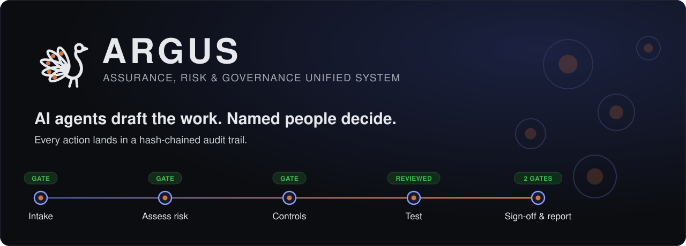

# ARGUS

### The AI governance, risk and assurance workbench, where AI agents draft the work and named people decide

<p>


</p>

[**Quick Start**](#-quick-start) · [**See It**](#-see-it) · [**How It Works**](#-how-it-works) · [**Agents**](#-the-agents) · [**Controls**](#-governance-built-into-the-harness) · [**Commands**](#-commands) · [**API**](docs/API.md) · [**Plain-Language Docs**](docs/README.md)

</div>

**ARGUS (Assurance, Risk & Governance Unified System) runs AI assurance engagements from first idea to board report.** Each AI use case is a card that moves across a board. Agents draft the work at each stage, a named person approves at each gate, and every action is written to an audit trail that can be verified.

- 🧑‍⚖️ **Agents draft. People decide.** No agent approves a gate, concludes a test, accepts a risk, closes an issue or signs off a report. Segregation of duties stops anyone approving their own work.
- 🔎 **Grounded, checked output.** Agents cite the knowledge base by passage id, and the server rejects any citation or figure they weren't given. Every draft is decided item by item.
- 🧾 **Evidence, not opinions.** Evidence is fingerprinted with SHA-256, tests have a preparer and a reviewer, and the audit log is hash-chained.
- 🏠 **Runs anywhere.** No database or Docker needed on a laptop (embedded Postgres), any model provider or the free offline rules, and a ready-made Cloudflare deployment.

> **New here, or not technical?** Start with the plain-language docs in [docs/](docs/README.md): what it is, how it works, a tour with screenshots and step-by-step runbooks. This README is the developer reference. Context for Claude is in [CLAUDE.md](CLAUDE.md).

---

<div align="center">

## 👁 See It

Every page belongs to the engagement chosen in the switcher. These screenshots are from the demo data (fictional clients).

</div>

<table>
<tr>
<td width="50%" valign="top">
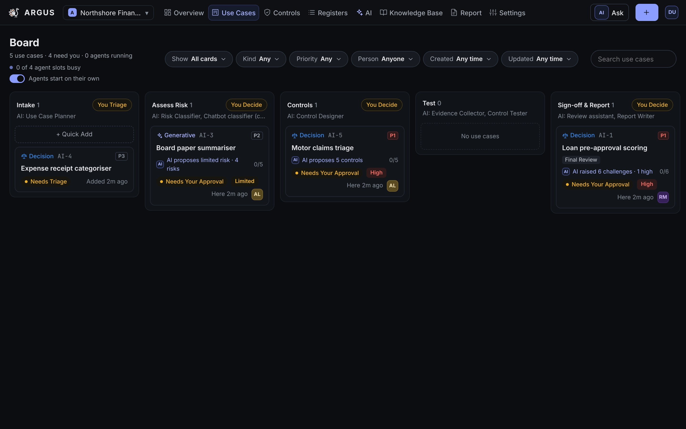
<p align="center"><b>The board.</b> Use cases move through five steps. Gate badges show where a person must sign off.</p>
</td>
<td width="50%" valign="top">
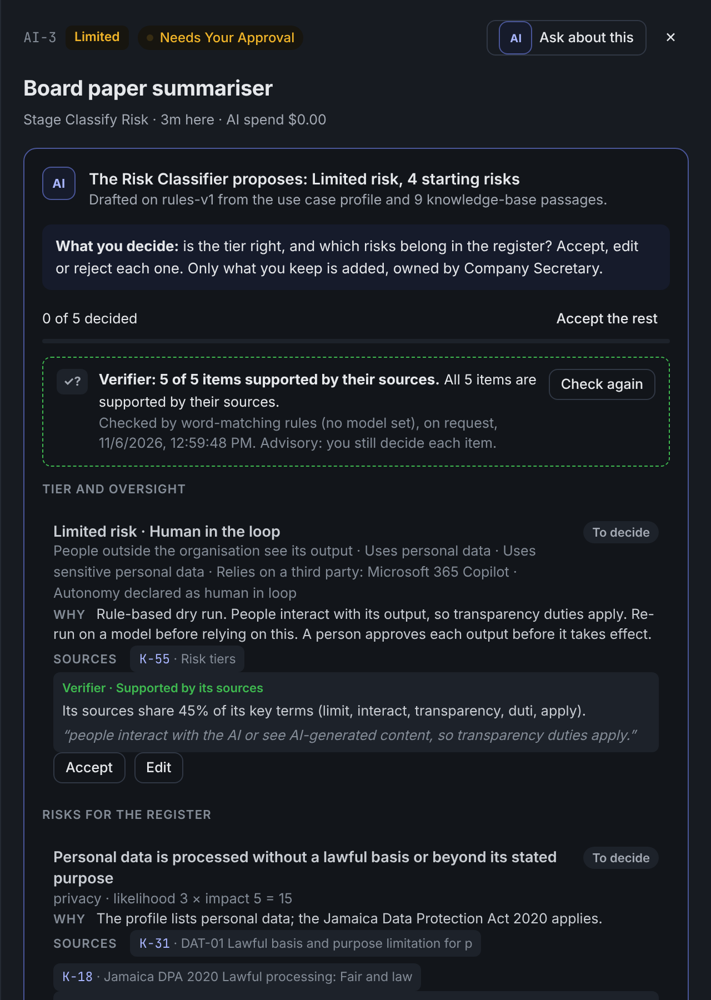
<p align="center"><b>Drafts decided item by item.</b> The Risk Classifier's tier and risks, each kept, edited or rejected by a person.</p>
</td>
</tr>
<tr>
<td width="50%" valign="top">
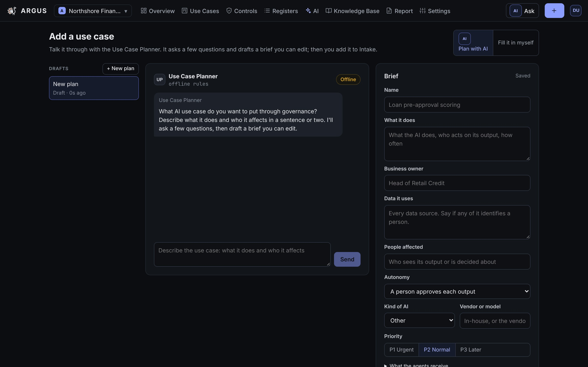
<p align="center"><b>Use Case Planner.</b> Talks a new use case through and drafts its brief. A person adds it.</p>
</td>
<td width="50%" valign="top">
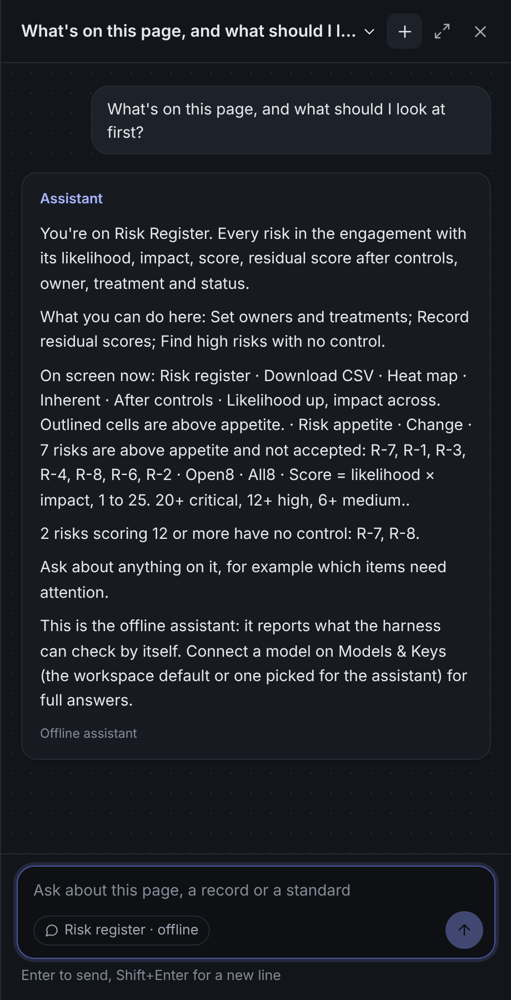
<p align="center"><b>The assistant.</b> Answers about the page you're on, shows what it looked up, and only ever suggests.</p>
</td>
</tr>
<tr>
<td width="50%" valign="top">
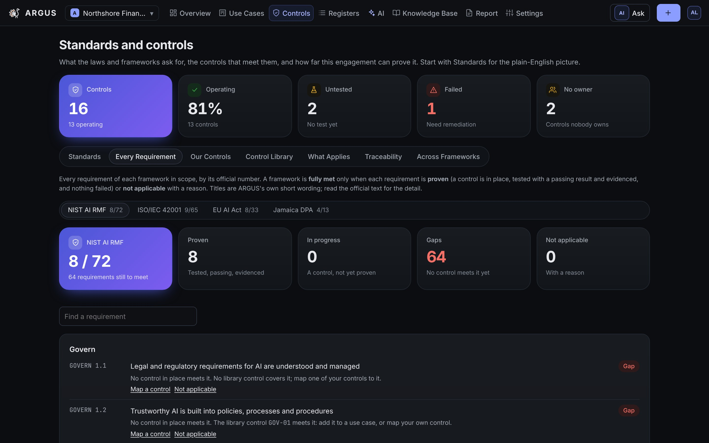
<p align="center"><b>Every requirement.</b> A framework is fully met only when each requirement is proven or not applicable with a reason.</p>
</td>
<td width="50%" valign="top">
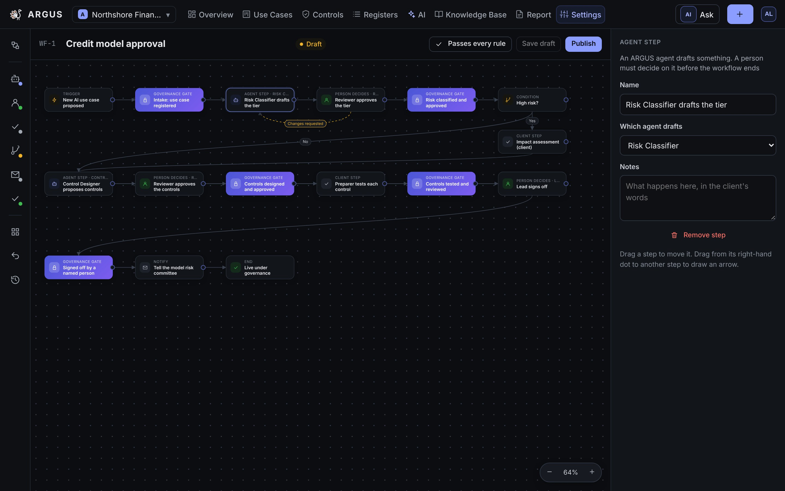
<p align="center"><b>Client workflows.</b> Build the client's own process around ARGUS's gates, which can't be removed or skipped.</p>
</td>
</tr>
<tr>
<td width="50%" valign="top">
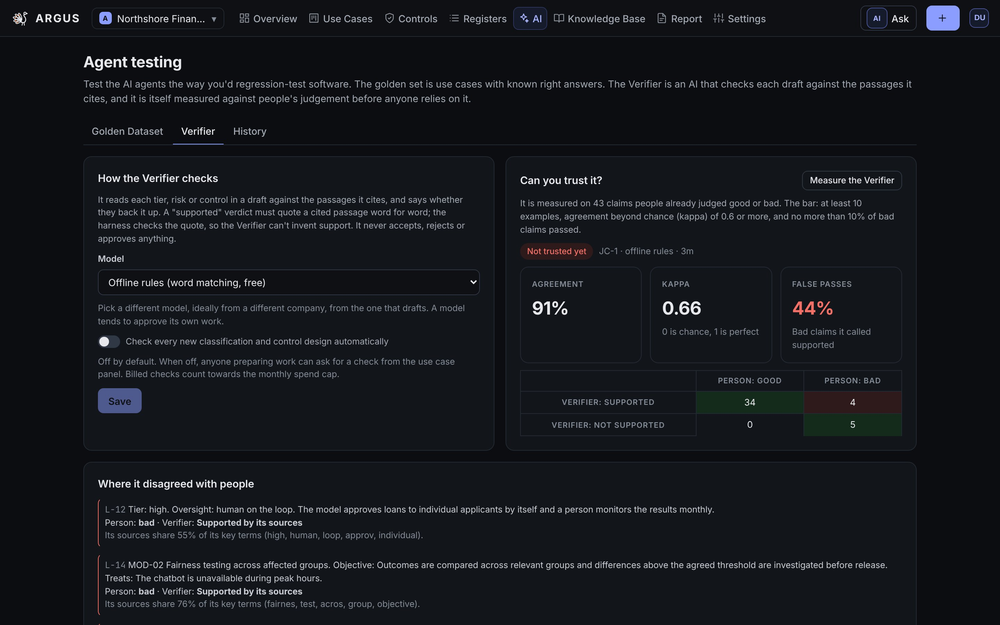
<p align="center"><b>Checking the AI.</b> Golden runs, and the Verifier measured against people's labels (agreement, kappa, false passes).</p>
</td>
<td width="50%" valign="top">
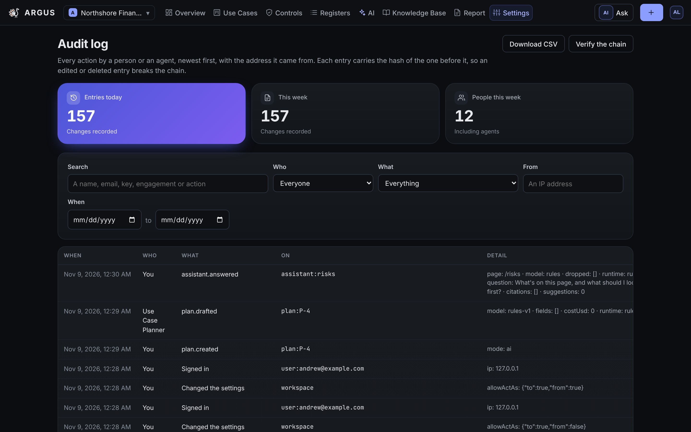
<p align="center"><b>The audit log.</b> Every action, who did it and from where. Verify the hash chain from the page.</p>
</td>
</tr>
</table>

---

## 🚀 Quick Start

Needs Node 20.12 or later. No database or Docker needed: it uses an embedded Postgres (PGlite) stored in `data/`.

```bash
npm install
npm run dev
```

Open http://localhost:5173. The API runs on port 4300.

On first open you create the **admin account** (name, email, password). Your name is how your approvals appear in the audit trail. Add colleagues under **More > People and roles**: segregation of duties means you'll want at least one other approver to take a use case all the way through.

The first start also creates a demo engagement, **Client Zero**, with four use cases in Intake, an AI inventory (including two agents) and two evaluation suites. Out of the box the agents run on the **built-in rules** (offline, free), and the eval suites target `demo-chatbot-v1`, a deliberately imperfect bank chatbot, so the whole flow works with no API key. For five full demo engagements, run `npm run demo` ([runbook](docs/runbooks/load-the-demo-data.md)).

<details>
<summary><b>A first walk-through that touches everything</b></summary>

1. **Board**: open AI-2, send it to classification, approve the classification, then approve the proposed controls.
2. **Controls**: see the new controls in the register, decide a few Statement of Applicability rows, and watch the traceability matrix show what's still a gap.
3. **Testing**: as a preparer, record a result and attach a file; as someone else, review it. Raise an issue from a failed test.
4. **Evals**: run the red-team suite and raise issues from the failed cases.
5. **Risks**: set residual likelihood and impact, accept what's within appetite.
6. **Report**: score the seven areas, then have a different lead sign it off.

</details>

### Connect a model

1. Open **Models** in the top bar.
2. Either edit the **Anthropic** card and paste a key, or click **+ Add provider** and pick a type:

   | Type | Base URL | Key | Use it for |
   | --- | --- | --- | --- |
   | Anthropic API | `https://api.anthropic.com` | From console.anthropic.com | Claude models |
   | Ollama Cloud | `https://ollama.com` (no `/v1`) | From ollama.com/settings/keys | Hosted open models |
   | OpenAI-compatible | Usually ends in `/v1` | Optional for local servers | OpenAI, Azure OpenAI, OpenRouter, LM Studio, vLLM, llama.cpp |

3. Click **Test and find models**. The harness lists the provider's models; add any it doesn't list by ID.
4. If the provider is **billed**, give each model a price (USD per million input, cached and output tokens). Anthropic's current models have default prices built in.
5. Open **Settings > Agents**, pick the Risk Classifier, choose the provider and model, optionally a fallback, and save. The top bar badge changes from **Dry run** to **Live agents**.

Setting `ANTHROPIC_API_KEY` in `.env` still works: the Anthropic provider uses it when it has no key of its own. To use a real Postgres instead of PGlite, set `DATABASE_URL` in `.env`.

---

## 🧩 Feature Grid

| | |
|---|---|
| 🗂 **Engagements** | One per client, added with a five-step wizard: client, scope (frameworks, risk appetite), gates, models, review. Archive to make one read-only, restore any time, or delete for good with the audit kept. |
| 🧠 **Seven AI agents** | The Use Case Planner, Risk Classifier and Control Designer, plus four drafting agents. Agentic (read-only look-ups, questions for a person, a self-check) or single call. Leads can add more per stage. |
| 🚦 **Gates and exit criteria** | A person signs off at each gate. Exit criteria are checks, not reminders: no leaving Design with an uncontrolled high risk, or Test without a reviewed result. |
| 📚 **Grounded in a knowledge base** | Keyword and meaning search over the method and the client's own documents, split at their headings. Agents must cite what they were given. |
| 🛡 **Control library and frameworks** | A library mapped to 9 frameworks (NIST AI RMF, ISO/IEC 42001, EU AI Act, Jamaica DPA, NIST CSF 2.0, COSO, OWASP, FDA GMLP, HIPAA), a Statement of Applicability, traceability, Across Frameworks and Every Requirement. |
| 🧪 **QA-style testing** | Tests with preparers and reviewers, an evidence vault, issues with a defect-style lifecycle, and evaluation and red-team suites with an LLM judge. |
| 🔌 **The client's own tools** | Read-only connectors to 24 kinds of business tool, client steps checked per use case, opt-in create-only write-back, and evidence pushed from CI/CD pipelines with ingest tokens. |
| 💬 **An assistant that only suggests** | Sees the page you're on, shows its steps live, and offers changes a person applies under their own role, or discards. |
| 🔬 **Checking the AI** | Golden runs with regression tracking, retrieval scores, and the Verifier, an advisory LLM-as-a-judge measured against people. |
| 💰 **Cost under control** | Prices per model, a monthly spending limit with a pause, per-run limits, and keys encrypted with AES-256-GCM that agents and the browser never see. |

---

## 🧭 How It Works

<p align="center">
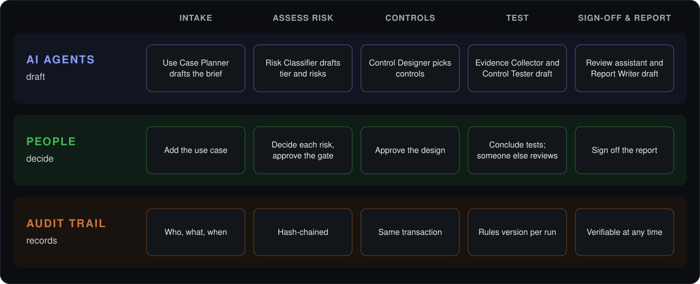
</p>

People see five steps; underneath, a card moves through eight stages, and every stage check still runs:

```
Intake ─▶ Classify risk ─▶ Design controls ─▶ Collect evidence ─▶ Test controls ─▶ Remediate ─▶ Validate ─▶ Board report ─▶ Closed
 (gate)     (gate, agent)      (gate)                                                            (gate)        (gate)
```

What happens when a use case reaches a stage with an agent:

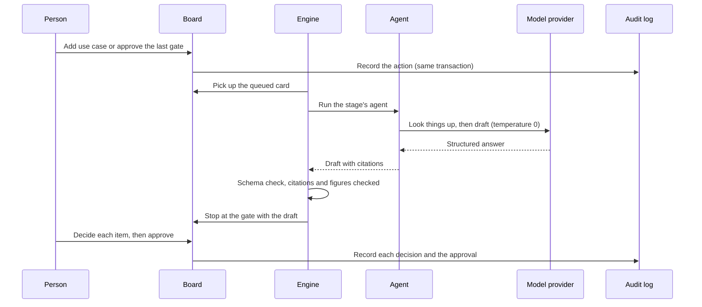

- **Cards** are AI use cases. Each has a profile: owner, what it does, data used, people affected, autonomy, vendor.
- **Gates** stop a card until a person signs off. Defaults: Intake (always), Classify, Design, Validate, Report. Change them in Settings > Approval gates.
- **Agents** are configured per engagement, one or more per stage, and ship switched off unless they're the core ones.
- **Agentic agents** (v1.6, `agent-loop.ts`, `tools.ts`): each run is a loop of model steps. The agent can call read-only tools as often as it needs, then hands in its draft through its final tool; the last allowed step forces that. It may ask a person once or twice per stage (`ask_person`): the run stops as waiting, the card shows Question for You, and answering or skipping queues it again with the answers. It checks its draft once against `prompts/<role>.critique.md`. Models without tool calls, and the offline rules, run as one call.
- **Exit criteria** are checks, not reminders. A failed test also can't leave the Test stage until an issue is raised for it. A card can't leave Design until every risk scoring 12+ has a control, Evidence until every control has evidence, Test until every test has a reviewed result, Remediate until no critical or high issue is open (`board/exit-criteria.ts`).
- **The engine** (`board/engine.ts`) polls every 1.5 seconds and picks up queued cards in stages with an enabled agent. It respects each agent's **runs at once**, each provider's **requests at once** and 4 slots overall. It runs the agent on its provider and model, falls back to the fallback model if the first call fails or the provider is off, records the run and its cost, then stops at the gate or moves the card on.
- **Risk Classifier** (`agents/risk-classifier.ts`) returns a tier (prohibited, high, limited, minimal), an oversight model, the factors behind the tier, 2 to 6 starting risks, open questions and framework references. Every provider is asked for one structured answer that matches a JSON schema (`ai/llm.ts`); the server then validates it with Zod, and anything else fails the run.
- **Control Designer** (`agents/control-designer.ts`) picks controls from the library for each approved risk, adds the baseline controls a tier needs, and writes a test approach for each. It may only cite library codes that exist.
- **Approving** a classification writes its risks to the **risk register**; approving a design writes the controls, links them to the risks they treat and creates a draft test for each, all in one transaction. **Request changes** sends your note back to the agent.

---

## 🤖 The Agents

| What an agent **can** do | What an agent **can never** do |
|---|---|
| Draft a brief, a classification, a control design, evidence requests, test results, review challenges and a board summary | Approve a gate, conclude a test, or count as a preparer or reviewer |
| Look things up with read-only tools: the knowledge base, use cases, past decisions, registers, evidence | Write, send or change anything through its tools |
| Ask a person a question (at most two per stage) | Accept a risk, close an issue or sign off a report |
| Cite passages it was given or found in that run | Cite anything else, or quote a figure that isn't in its data |

### Drafting agents

Four agents draft and never decide. They ship **switched off**: a lead turns each one on per engagement in Settings > Agents.

| Agent | Stage | Drafts | Guardrails |
| --- | --- | --- | --- |
| Evidence Collector | Collect evidence | An evidence request list per control, matched against what's uploaded | Only this use case's control and evidence keys are accepted |
| Control Tester | Test controls | A suggested result on each open test, citing evidence | It never concludes a test or becomes the preparer. A person starts from the draft (recorded in the audit trail), concludes as preparer, and someone else reviews. Drafts proposing a pass with exceptions, a pass without evidence, or citing evidence not attached to that test are rejected. The offline rules never propose a pass |
| Review assistant | Validate | Challenges for the person signing off: thin samples, notes-only evidence, failed tests with no issue, risks above appetite, the same person preparing and reviewing under different names | The rule-based checks always stand; a model can add findings but not remove them or call the pack ready while a high finding is open. It is not a second-line review |
| Report Writer | Board report | A board summary for the use case | Every number must appear in the data it was given, or the draft is rejected. Only a summary a person approved goes in the readiness report |

What applies to all four:

- **They always stop for a person.** Their stages stop after the agent runs, whether or not the stage has a gate, and the exit criteria still apply.
- **The output is checked before anyone sees it.** It must match a schema, and the server checks every key and figure it cites.
- **Client material is treated as data.** Evidence contents are wrapped as data, and instructions inside them are ignored.
- **The agents can't see everything.** They read notes and text files only, not PDFs, spreadsheets or links. When they can't see something, they say so.

---

## 📊 By the Numbers

| | |
|---|---|
| API routes | **170**, each with its permission, listed in [`docs/API.md`](docs/API.md) and [`openapi.json`](docs/api/openapi.json) |
| Frameworks | **9**, each with its complete requirement list |
| Business tools a client workflow can name | **24** |
| Stages | **8**, shown to people as **5** steps |
| Roles | **5**, plus segregation of duties on every approval |
| Test suites | **14**, each run on a fresh database, including a mock model that tries to cheat the guardrails |

---

## 👥 People, Roles and Segregation of Duties

| Role | Can |
| --- | --- |
| Admin | Everything, including people, models and workspace settings |
| Engagement lead | Engagement settings and gates, agents, accept any risk, sign off the report |
| Reviewer | Approve gates, review tests, accept risks within appetite, close issues |
| Preparer | Add use cases, controls, tests, evidence and issues |
| Viewer | Read everything |

Renaming yourself is allowed (Your account), but your old names stay attached to you: you still can't approve work you signed under an earlier name, and nobody else can take that name. A session ends after 12 hours without use or 7 days after sign-in.

On top of roles: nobody approves a use case they added, reviews a test they prepared, closes an issue without a passed and reviewed retest, or signs off a report whose areas they scored alone. A reviewed test result is locked; a retest is a new test. Passwords are hashed with scrypt; sessions are random tokens stored hashed, in an HttpOnly cookie.

### Providers and cost

- Keys are encrypted with AES-256-GCM before they're stored. The encryption key is `SECRET_KEY` (64 hex characters) or, if unset, `data/secret.key`, generated on first run. Back that file up with the database; without it saved keys can't be read.
- The browser only ever sees `••••` plus the last four characters. Agents never see keys: the server makes the model call.
- Cost per run = input × input price + cached × cached price + output × output price, per million tokens. Unbilled providers (your own server, the built-in rules) cost $0 and don't count toward the cap.
- **Effort** sets the output budget: low 2k, medium 4k, high 8k, xhigh 12k, max 16k tokens.
- **Spending limit:** when this month's billed spend reaches the cap and **pause at the cap** is on, billed runs stop with a note on the card (an unbilled fallback still runs). The month starts in the chosen time zone.

---

## 🛡 Governance Built Into the Harness

| Control | Where |
| --- | --- |
| Agents never approve; a named person does at each gate. "Approve or sign off" is shown as a tool no agent can have | `board/board-routes.ts` card actions, Settings > Agents |
| The harness's rules for each role load from server files; an engagement's instructions are appended after them and can't replace them; the use case text is wrapped as data | `agents/prompts/`, `agents/risk-classifier.ts` |
| Agent output must pass a schema before anyone sees it | `Classification` in `packages/shared` |
| Every change and its audit row commit in one transaction; key, token, secret and password fields are redacted | `audit/audit.ts` |
| API keys encrypted at rest and never sent to the browser or to agents | `core/crypto.ts`, `ai/providers.ts` |
| Append-only run history with every step, model, provider, tokens and cost | `runs`, `run_events` tables |
| Monthly spend cap with warning threshold and pause; per-run spend limit and timeout | `board/engine.ts`, Models page, Settings > Agents |
| A provider in use by an agent can't be removed; an unbuilt agent can't be switched on | `ai/provider-routes.ts`, `agents/agent-routes.ts` |
| Runs left running by a crash are closed on startup | `board/engine.ts` |
| Sign-in, five roles, segregation of duties on approvals, test reviews, issue closure and report sign-off | `auth/auth.ts`, `auth/auth-routes.ts` |
| Audit log is hash-chained (each entry stores the previous hash) and can be verified from the Audit page | `audit/audit.ts` |
| Every run is stamped with the sha256 of the agent's rules file, so a result can be tied to the exact rules that produced it | `runs.rules_version` |
| Each agent has a kill switch that fails running work safely; testing it records the date | Settings > Agents, `POST /agents/:id/kill` |
| Evidence is fingerprinted with SHA-256 on collection and can be re-verified; evaluation runs are filed as evidence automatically | `testing/evidence-routes.ts`, `evals/eval-runner.ts` |

These follow decisions recorded in the Anser repo's ADRs 022, 024, 025 and 028 (see `../docs/adr/`). The full list of rules the code must keep is in [CLAUDE.md](CLAUDE.md) under "Rules that must not break".

---

## 🗂 Engagements and Pages

### Adding a client or project

Open the engagement switcher next to the logo and choose **+ Add engagement** (admins and leads). The wizard has five steps:

1. **Client**: client, sector, engagement name, card prefix (filled in from the client's initials, must be unique), colour, and what the client does and who regulates them. Agents read that as context.
2. **Scope**: frameworks in scope. The harness shows how many library controls and obligations they bring in, and can start the Statement of Applicability with those marked applicable for you to confirm. Set the risk appetite, and optionally paste use cases, one per line, to land in Intake.
3. **Gates**: where a reviewer or lead signs off. Intake is always gated.
4. **Models**: Claude for every agent, the workspace default, or the built-in rules, then adjust per agent.
5. **Review**: check, then add. You land on the new engagement's board.

### Archiving and deleting

In **Settings > General**, a lead can **archive** an engagement: it becomes read-only (the server refuses every change to it, and agents stop picking up its work), moves to an Archived section of the switcher, and can be **restored** at any time. Nothing is removed. **Download the full record** gives a JSON file of everything in it, including its audit entries.

Once it's archived, an admin can **delete** it permanently by typing its name. That removes its use cases, risks, controls, tests, evidence (and evidence files no other engagement uses), issues, evaluations and runs. The audit log keeps every entry about it, plus who deleted it and counts of what went. The last active engagement can't be archived.

Every page belongs to the engagement chosen in the switcher; the choice is remembered per browser. Settings changes the engagement later.

### Pages

| Page | What's on it |
| --- | --- |
| **Overview** | Classification coverage, open high risks, what needs you, spend against the cap, runs, use cases by tier |
| **Board** | Nine stages with gate badges, filters, search, agent slots. A use case opens in a drawer with its gate actions, exit criteria, risks and controls |
| **Risks** | Inherent and residual heat maps, risk appetite, residual likelihood and impact, controls per risk, acceptance (above appetite needs a lead); CSV |
| **Controls** | **Register** (controls per use case, owner, status, tests, evidence, issues), **Library** (controls mapped to the frameworks above), **Statement of Applicability**, **Traceability** (obligation → library control → control → test → evidence, with gaps), **Across Frameworks**, **Every Requirement**; CSV for each |
| **Testing** | **Tests** (design, operating, automated and retest; procedure, population, sample, expected, actual, exceptions; preparer and reviewer), **Evidence vault** (files, links and notes, SHA-256 on collection, verify and download) |
| **Issues** | Severity, owner, due date, overdue flag, management response; lifecycle open → in remediation → ready for retest → closed, or risk accepted with a reason |
| **Evals** | Quality and red-team suites against any provider and model; checks: contains, must not contain, pattern, refuses, length, judge model; results by category; raise issues from failures |
| **Inventory** | AI systems, models, agents, datasets and vendor AI with owners; the agent register checks eight conditions before an agent may act alone |
| **Report** | Readiness assessment across seven areas with suggested scores and your rationale; printable report; Markdown download; sign-off |
| More › **Runs**, **Settings**, **Models** | Agent runs and their logs; engagement settings, gates, agents (with kill switch and rules version); providers, keys, prices and the spending limit |
| Account menu › **Your account** | Display name, password, where you're signed in, sign out one session or everywhere |
| Account menu › **People and roles** | Admin only: add people, change roles, reset passwords, disable |
| Account menu › **Audit log** | Every action with the address it came from; search and filter by who, what, address and date; pages; CSV; verify the hash chain |
| Account menu › **Theme**, **Desktop notifications** | System, light or dark; a browser notification when a use case needs your approval and the tab is in the background |

---

## ⌨ Commands

| Command | What it does |
| --- | --- |
| `npm run dev` | Web on http://localhost:5173, API on port 4300 |
| `npm run db:reset` | **Stop the app first.** Deletes every account and record and reseeds Client Zero; the next visit asks you to create the first admin. Also recovers a damaged embedded database. Keeps `data/secret.key` |
| `npm run build` then `npm start` | Builds the web app and serves it from the API on port 4300 |
| `npm run typecheck` | Type-checks server and web |
| `npm run check` | ESLint, Prettier check, typecheck and `check:docs` together (`docs/CODING-STANDARDS.md`); `lint`, `lint:fix`, `format` and `format:check` run them one at a time |
| `npm run docs` | Rebuilds the API reference (`docs/API.md`, `docs/api/openapi.json`) and the README in each feature folder from the code. `npm run check:docs` fails if they're out of date |
| `npm run demo` | On a **fresh** database with the app running: builds the demo engagement as five fictional people (password `correct-horse-9`, or set `DEMO_PASSWORD`). See docs/runbooks/load-the-demo-data.md |
| `npm run demo:build` / `demo:list` / `demo:load -- <copy>` / `demo:save -- <name>` | Saved demo copies: `all` and one per client; build, list, switch (app stopped; current data backed up first), or save the current state |
| `npm run demo -- --list` | List the demo engagements; `--only=<name>` builds one (plus Northshore) |
| `npm run versions` | List versions; `-- use v1.1` switches (backing up data); `-- latest` returns |
| `npm run lessons` / `check:lessons` | Rebuild the lessons index; check the lessons and the code checks behind them |

<details>
<summary><b>Test suites</b> (each needs a <b>fresh</b> database: stop the app, <code>npm run db:reset</code>, start it)</summary>

| Command | What it does |
| --- | --- |
| `npm run smoke` | API smoke test (66 checks) against a running server on a **fresh** database. It creates test accounts (password `correct-horse-9`), so reset afterwards before real use |
| `npm run test:agents` | Drafting-agent tests (30 checks), including a mock model that tries to cheat the guardrails |
| `npm run test:grounding` | Grounding tests (31 checks): knowledge base, citations, item-by-item decisions, meaning search, temperature 0 |
| `npm run test:assistant` | Assistant tests (39 checks): offline and live, conversations, page questions, the workspace-default model, dropped citations and suggestions, apply under the person's role, discard, spend cap, JSON fallback |
| `npm run test:operations` | Operations tests (58 checks): file reading, incidents, monitoring and drift, connectors and the private-network guard, members-only access, SSO against a mock provider |
| `npm run test:v11` | v1.1 tests (65 checks): the Use Case Planner on rules and a mock model, new agents and routing, act as, provider service names, Overview activity |
| `npm run test:v12` | v1.2 tests: modules per engagement, and the five steps still running every stage check |
| `npm run test:v15` | Flaky providers (429, cut-off and malformed answers, rules fallback), Planner context, assistant instructions, golden runs with an engagement's context |
| `npm run test:v16` | v1.6 tests (34 checks): the agent loop, single-call mode, models without tool calls, the step limit, refused tools, members-only records, the self-check, questions (pause, answer, skip, audit), the assistant's look-ups, golden runs by mode |
| `npm run test:v17` | v1.7 to v1.7.2 tests (46 checks; set ARGUS_MS_TOKEN_URL and ARGUS_GOOGLE_TOKEN_URL to the mock for the sign-in checks): client workflows and their rules, versions and audit; the KPI read; the assistant's steps, @ tags, ratings and actionable errors; client tools and the workflow drafted with a new engagement |
| `npm run test:v173` | v1.7.3 tests (58 checks; start the server with MONITOR_TICK_MS=1000 so write-back sends quickly): healthcare frameworks, mapping across frameworks, pipeline pushes and tokens, S3 and Azure Blob reads, client step proof, write-back and its audit |
| `npm run test:v174` | v1.7.4 tests (35 checks; server with MONITOR_TICK_MS=1000): the module, following no workflow and the engagement default, tracked-only steps, confirm only manual steps, scheduled checks, Verifier wording, every requirement (complete lists, gaps, mapping, not applicable with a reason, fully met) |
| `npm run test:verifier` | Verifier and agent-testing tests (36 checks): golden runs and regressions, the quote check, calibration, live checks, spend cap |
| `npm run test:rag` | Retrieval tests (8 checks): recall and MRR with keyword and meaning search, heading-aware passages with overlap, the per-document cap |

</details>

---

## 🏗 Architecture and Layout

```
Browser (Vue 3, Pinia) ──▶ Express API (sign-in, access, archive guard) ──▶ Feature routes ──▶ Postgres or PGlite
                                   │                                              │
                                   └── Engine ──▶ Agents ──▶ Model providers       └── Evidence files (disk or R2)
```

Code is organised by feature: `apps/server/src/<feature>/`, `apps/web/src/features/<feature>/` and one file per domain in `packages/shared/src`. **Each feature folder has its own README** (what it is for, its files, its routes or pages), and every API route is listed in [`docs/API.md`](docs/API.md) (also as OpenAPI in [`docs/api/openapi.json`](docs/api/openapi.json)); all of these are generated by `npm run docs`. The full map is in `CLAUDE.md` under Layout; the rules the code follows are in [`docs/CODING-STANDARDS.md`](docs/CODING-STANDARDS.md).

```
packages/shared/src        Domain model: Zod schemas, types and labels, one file per domain (import from '@gh/shared')
apps/server/src
  index.ts                 HTTP server, Socket.IO, startup, middleware order
  api-router.ts            Registers every feature's routes
  core/                    Database, schema.sql, paths, crypto, storage, realtime, shared HTTP helpers
  <feature>/               audit, auth, engagements, board, agents, ai, settings, assistant, knowledge, agent-testing,
                           controls, testing, issues, inventory, evals, monitoring, reporting, risks, incidents,
                           integrations; each with its logic and *-routes.ts files
  setup/                   seed.ts (Client Zero demo) and reset.ts
apps/web/src
  features/<feature>/      Pages and components per feature (same names as the server)
  components/, lib/        Shared building blocks and helpers
data/                      PGlite database, secret.key and evidence/ files named by hash (gitignored)
scripts/                   Test suites, demo data, lesson checks, docs/build-docs.mjs
```

### API

The full reference, with every route's permission and request fields, is generated in [`docs/API.md`](docs/API.md). The table below is a quick map.

<details>
<summary><b>Endpoints at a glance</b></summary>

| Area | Endpoints |
| --- | --- |
| Board | `GET /api/engagements`, `POST /api/engagements`, `POST /api/engagements/:id/archive`, `POST /api/engagements/:id/restore`, `GET /api/engagements/:id/export`, `DELETE /api/engagements/:id`, `GET /api/engagements/:id/board`, `POST /api/engagements/:id/cards`, `GET /api/cards/:key`, `POST /api/cards/:id/actions` (`approve`, `request_changes`, `retry`, `advance`, `reject`), `POST /api/cards/:id/questions/:qid/answer` (`{ answer }`), `POST /api/cards/:id/questions/:qid/skip`. `GET /api/cards/:key` includes `questions` |
| Runs, risks, audit | `GET /api/runs`, `GET /api/runs/:id`, `GET /api/engagements/:id/risks`, `PATCH /api/risks/:id`, `GET /api/engagements/:id/overview`, `GET /api/audit` (`q`, `actor`, `action`, `ip`, `from`, `to`, `page`, `pageSize`) |
| Settings | `GET /api/settings`, `PUT /api/settings`, `PATCH /api/engagements/:id` |
| Client steps (v1.7.3) | `GET /api/cards/:id/client-steps`, `PUT /api/cards/:id/workflow` (`{ workflowId }`), `POST /api/cards/:id/client-steps/check`, `POST /api/cards/:id/client-steps/:node/confirm` (`{ link, note }`), `DELETE /api/cards/:id/client-steps/:node` |
| Write-back (v1.7.3) | `PATCH /api/engagements/:id` (`{ writeBack }`), `GET/POST /api/engagements/:id/outbound`, `PATCH/DELETE /api/outbound/:id`, `POST /api/outbound/:id/test` |
| Pipelines (v1.7.3) | `GET/POST /api/engagements/:id/ingest-tokens`, `DELETE /api/ingest-tokens/:id`, `POST /api/ingest/evidence` (Bearer ingest token; `title`, `kind`, `useCase`, `control`, `content` or `contentBase64` with `filename` and `mime`, `url`, `source`, `metrics`) |
| Across frameworks (v1.7.3) | `GET /api/engagements/:id/harmonization`, `POST /api/controls/:id/map` (`{ libraryCode }`) |
| Assistant chats (v1.7.4) | `PATCH /api/engagements/:id/assistant/conversations/:cid` (`{ title }`), `DELETE /api/engagements/:id/assistant/conversations/:cid`; `POST /api/engagements/:id/assistant` takes `replaceFrom` (one of your question ids) to edit a question |
| Every requirement (v1.7.4) | `GET /api/engagements/:id/requirements` (`?framework=`), `PUT /api/engagements/:id/requirements/:framework` (`{ ref, applicable, reason }`), `POST /api/controls/:id/refs` (`{ framework, ref, remove }`); `PUT /api/cards/:id/workflow` takes `{ mode: auto, none or pinned, workflowId }` |
| Providers | `GET /api/providers`, `POST /api/providers`, `PATCH /api/providers/:id`, `DELETE /api/providers/:id`, `POST /api/providers/:id/test`, `POST /api/providers/test` |
| Workflows | `GET/POST /api/engagements/:id/workflows` (`template`: standard or minimal), `GET/PATCH /api/workflows/:id` (a graph without the gates is refused), `POST /api/workflows/:id/publish` (`note`; 409 with problems), `GET /api/workflows/:id/versions/:v`, `POST /api/workflows/:id/restore` (`version`), `POST /api/workflows/:id/retire`. A step's `config` may name a `tool` (see `BUSINESS_TOOLS`), `toolDetail` and a `connectorId` |
| KPIs | `GET /api/engagements/:id/kpis` (the numbers behind every page's tiles) |
| Agents | `GET /api/engagements/:id/agents`, `PATCH /api/agents/:id` (incl. `mode` agentic or single, `maxSteps` 2 to 20, `selfCheck`, `tools`) |
| Auth and people | `PATCH /api/auth/me`, `GET /api/auth/sessions`, `DELETE /api/auth/sessions/:id`, `POST /api/auth/sessions/end-all`, `GET /api/auth/state`, `POST /api/auth/setup`, `POST /api/auth/login`, `POST /api/auth/logout`, `POST /api/auth/password`, `GET/POST /api/users`, `PATCH /api/users/:id` |
| Controls | `GET /api/library`, `POST /api/library`, `GET /api/obligations`, `GET /api/engagements/:id/soa`, `PUT /api/engagements/:id/soa/:libraryId`, `GET/POST /api/engagements/:id/controls`, `PATCH /api/controls/:id`, `GET /api/engagements/:id/traceability` |
| Inventory | `GET/POST /api/engagements/:id/inventory`, `PATCH /api/inventory/:id` |
| Testing and evidence | `GET/POST /api/engagements/:id/tests`, `PATCH /api/tests/:id`, `POST /api/tests/:id/review`, `GET /api/engagements/:id/evidence`, `POST /api/evidence`, `GET /api/evidence/:id/verify`, `GET /api/evidence/:id/download` |
| Issues | `GET/POST /api/engagements/:id/issues`, `PATCH /api/issues/:id` |
| Evals | `GET/POST /api/engagements/:id/evals`, `GET /api/evals/:id`, `POST /api/evals/:id/cases`, `DELETE /api/eval-cases/:id`, `POST /api/evals/:id/run`, `GET /api/eval-runs/:id`, `POST /api/eval-runs/:id/issues` |
| Assessment and report | `GET /api/engagements/:id/assessment`, `PUT /api/engagements/:id/assessment/:area`, `GET /api/engagements/:id/report`, `POST /api/engagements/:id/report/sign` |
| Knowledge base | `GET /api/engagements/:id/knowledge`, `GET /api/engagements/:id/knowledge/search?q=`, `POST /api/engagements/:id/knowledge`, `GET /api/knowledge/passages/:kid`, `DELETE /api/knowledge/:id`, `POST /api/knowledge/reindex`, `POST /api/knowledge/embeddings/test`, `POST /api/cards/:id/decisions` |
| Agent testing | `GET /api/agent-testing`, `GET/POST /api/agent-testing/runs` (`mode`: agentic or single), `GET /api/agent-testing/retrieval` (recall@5/10 and MRR, keyword and hybrid), `GET /api/agent-testing/runs/:id`, `POST /api/agent-testing/cases`, `DELETE /api/agent-testing/cases/:id`, `POST /api/agent-testing/labels`, `POST /api/agent-testing/labels/import`, `DELETE /api/agent-testing/labels/:id`, `POST /api/agent-testing/calibrate`, `POST /api/cards/:id/verify` |
| Operations | `GET/POST /api/engagements/:id/incidents`, `PATCH /api/incidents/:id`, `PATCH /api/evals/:id/schedule`, `GET /api/engagements/:id/alerts`, `POST /api/alerts/:id/acknowledge`, `POST /api/alerts/:id/issue`, `GET/POST /api/engagements/:id/connectors`, `PATCH/DELETE /api/connectors/:id`, `POST /api/connectors/:id/pull` |
| Access and SSO | `GET /api/engagements/:id/members`, `PUT /api/engagements/:id/access`, `POST /api/engagements/:id/members`, `DELETE /api/engagements/:id/members/:userId`, `GET /api/auth/sso`, `GET /api/auth/sso/start`, `GET /api/auth/sso/callback`, `GET/PUT /api/sso/config` |
| Assistant | `GET /api/engagements/:id/assistant?kind=&contextId=` (your latest conversation about that record), `POST /api/engagements/:id/assistant` (`kind`: card, risks, controls, issues, engagement; `contextId`; `question`; `page: {path, snapshot}`; `conversationId` or `newConversation`; `requestId` to get live `assistant:step` events; @KEY in the question adds that record), `POST /api/engagements/:id/assistant/:messageId/feedback` (`value`: up, down or null), `GET /api/engagements/:id/assistant/conversations?q=` (yours, newest first; `q` searches every message), `GET/PATCH /api/engagements/:id/assistant/conversations/:cid` (open, rename), `POST /api/engagements/:id/assistant/:messageId/suggestions/:id/apply`, `.../discard` |
| Agents and audit | `POST /api/agents/:id/kill` (`{ test: true }` to test), `GET /api/audit/verify` |
| Health | `GET /api/health` |

</details>

Realtime events: `card`, `run`, `run:event`, `assistant:step` (to the asker only), `risk`, `audit`, `usage`, `engagement`, `issue`, `eval`, `golden`, `assistant`, `alert`, `incident`, `evidence`. Events about a members-only engagement go only to its members and admins. The socket needs a signed-in session.

---

## 📖 Documentation Guide

| Topic | What you'll find | Link |
|---|---|---|
| **What ARGUS is** | The plain-language overview, for anyone | [docs/01-what-it-is.md](docs/01-what-it-is.md) |
| **Using the app** | Every page and what to do on it | [docs/03-using-the-app.md](docs/03-using-the-app.md) |
| **The AI agents** | What each agent drafts, its guardrails, grounding and the Verifier | [docs/04-ai-agents.md](docs/04-ai-agents.md) |
| **Standards and controls** | Frameworks, the control library and how coverage is worked out | [docs/05-standards-and-controls.md](docs/05-standards-and-controls.md) |
| **Architecture** | How the pieces fit together | [docs/07-architecture.md](docs/07-architecture.md) |
| **Walkthrough and demo scripts** | A tour with screenshots; 15- and 30-minute demos | [Walkthrough](docs/08-walkthrough.md) · [Demo script](docs/09-demo-script.md) |
| **The manual** | The full user manual, also as a PDF | [docs/manual.md](docs/manual.md) · [PDF](docs/manual.pdf) |
| **Runbooks** | Step by step: install and run, load the demo data, connect a client system, back up and restore, deploy to Cloudflare and more | [docs/runbooks/](docs/runbooks/README.md) |
| **API reference** | Every route with its permission and request fields (generated) | [docs/API.md](docs/API.md) · [OpenAPI](docs/api/openapi.json) |
| **Coding standards** | The rules the code follows, from each framework's maintainers | [docs/CODING-STANDARDS.md](docs/CODING-STANDARDS.md) |
| **Lessons** | Pitfalls and decisions already found | [docs/LESSONS.md](docs/LESSONS.md) |
| **Changes** | What changed in each version | [CHANGELOG.md](CHANGELOG.md) |

---

## 🛣 Next to Build

1. **Running client workflows**: a published workflow driving the board and the agents (1.7.x).
2. **OCR** for scanned evidence.
3. **SSO beyond the scaffold**: SAML, sign-out at the provider, accounts from group claims; MFA inside the app.
4. **Connectors with OAuth** for document stores that need it (they read HTTPS report and export links today).
5. **Sign-in rate limiting.**

## ☁ Before You Put It on a Server

ARGUS can run online: a `Dockerfile` for the server and a Cloudflare Worker in `deploy/cloudflare/` (screens as static assets, the server as a Cloudflare Container, Postgres for data and R2 for evidence files). See [docs/runbooks/deploy-to-cloudflare.md](docs/runbooks/deploy-to-cloudflare.md).

- Put it behind HTTPS (and set `COOKIE_SECURE=true` so the session cookie is only sent over HTTPS). Set `SECRET_KEY` from a secrets manager rather than relying on `data/secret.key`.
- Back up `data/` (database, evidence files and the key) together. Evidence files are named by their hash, so a restored file that doesn't match fails verification.
- Behind a reverse proxy, set `TRUST_PROXY=true` so the audit log records the client's address rather than the proxy's.
- There's no rate limit on sign-in yet; put the app behind a proxy that has one, or add it before exposing it to the internet.

---

## 🕰 Release History

Built on the structure of GoldenEye (the delivery harness): same board-and-gate engine, run log, Models & keys page, tabbed Settings, spend cap and design system, with a governance domain in place of software delivery. Every release is a git tag; `npm run versions` goes back and forward. The full list is in [CHANGELOG.md](CHANGELOG.md).

<details>
<summary><b>What each version added</b></summary>

- **v1.7.5 to v1.7.8** (code quality; behaviour unchanged): coding standards, ESLint, Prettier and a pre-commit hook; code organised by feature; long functions and large screens split; a JSDoc comment on every export; the API reference and feature READMEs generated by `npm run docs`.
- **v1.7.4** adds Controls > Every Requirement (the complete requirement list for each framework, with fully met only when each is proven or not applicable), plainer sources and Verifier wording on drafts, use cases that follow no client workflow (and an engagement default), tracked-only client steps, scheduled checks, an optional sign-off requirement on client steps, and makes client tools and workflows a module.
- **v1.7.3** makes client workflows do something: each client step can say what proves it, and each use case shows its Client steps, checked in the client's tools through connectors. It adds write-back (off by default: Teams or Slack messages, Jira tickets, ServiceNow records, webhooks on set events, never edits), evidence pushed from CI/CD pipelines with ingest tokens (`POST /api/ingest/evidence`), S3, Azure Blob, GitHub, GitLab and Bitbucket reads, FDA GMLP and HIPAA, and Controls > Across Frameworks.
- **v1.7.2** moves connectors to Settings > Connected tools (with the tools the client uses), lets you add one in place from a workflow step, keeps a read-only From Client Tools view in Tests and Evidence, and adds an optional "How does the client work?" step to Add engagement that drafts a client workflow from a template. Settings > Workflow is now Approval gates.
- **v1.7.1** puts client workflow steps in the client's business tools (Microsoft 365, ServiceNow, Jira, Google Workspace, Slack, a GRC platform and others) and lets ARGUS read those tools through read-only connectors, with Microsoft Entra app and Google service account sign-in. ARGUS never writes to them.
- **v1.7** gives every working page the dashboard look (KPI tiles from `GET /engagements/:id/kpis`), adds **Client Workflows** (a builder for the client's own process around ARGUS's five governance gates, which can't be removed or skipped; versioned and audited), and makes the assistant work in the open: live steps, "Worked Ns · N steps", links to pages and records, @ to tag a record, thumbs up or down, and errors that say what to do. From here releases are 1.7.1, 1.7.2 and so on.
- **v1.6** makes the agents reason: they look things up with read-only tools (the knowledge base, use cases, similar cases and past reviewer decisions, registers, evidence), can ask a person a question (the use case shows **Question for You** until someone answers or skips), and check their own draft before handing it in. Every step is in the run log. Each agent can be switched between Agentic and Single call. The assistant looks things up too and shows what each answer was based on. Uploaded documents are split at their headings, and Checking the AI has a Retrieval tab that scores how well the knowledge base finds the right passage. See `docs/plans/v1.6-agentic-ai.md` and CLAUDE.md rules 23 to 27.
- **v1.5**: AI that bends instead of breaking: retries on busy providers, a second try when an answer is cut off, one repair attempt for format slips, the offline rules as a fallback; the Use Case Planner sees the client, the board and the knowledge base, handles unclear input and suggests use cases; the assistant has workspace instructions (`assistantInstructions` in settings); drafting agents search client documents; golden runs take `engagementId` for an engagement's context.
- **v1.4.1**: the assistant is a chat panel with formatted answers and conversation history; board cards show who last changed them (`updatedBy` on board cards); GoldenEye-style board filters; the version shows under Sign Out (`npm run release`, `CHANGELOG.md`); Save buttons stay disabled until something changes.
- **v1.4**: the assistant sees the page you're on, keeps your conversations (new, search, carry on) and uses the workspace default model when none is picked for it. `AGENTS.md`, `docs/LESSONS.md` and `docs/context/project-history.md` give agents the project's context and lessons.
- **v1.3** can run online: a `Dockerfile` for the server and a Cloudflare Worker in `deploy/cloudflare/`.
- **v1.2.2** puts Controls and the Knowledge Base in the top bar, adds icons to every menu item, uses title case for menus and board labels, lines up the workflow table, keeps Sign Out reachable in the account menu, adds **Upload Controls** (CSV or Excel, with a preview), and adds a step-by-step "Your path" chapter to the manual.
- **v1.2** renamed the app **ARGUS** (Assurance, Risk & Governance Unified System), with a Great Argus pheasant logo, and makes it simpler: five steps on the board (the eight stages and all their checks are unchanged underneath), six places in the top bar with AI as one of them, optional modules per engagement, plainer wording, a responsive layout, blinking status dots for anything that needs a person, and file buttons for uploads. The demo is now five engagements for fictional clients facing real kinds of AI risk, built from one file each in `scripts/demo/engagements/` so you can add your own.
- **v1.1** made AI part of the work from the first step: the Use Case Planner talks a new use case through and drafts its brief (or fill it in yourself), cards can be dragged between stages under the same rules as the buttons, a lead can add agents to a stage and route cards by kind or priority, an admin can act as anyone to run the whole flow alone (off by default, recorded in the audit log), and the board, Overview charts and settings follow GoldenEye's layout.
- **v1.0** closed the prototype's gaps: PDFs, Excel and Word files are read as evidence; incidents with EU AI Act and Jamaica DPA notification deadlines; scheduled monitoring with drift alerts; read-only evidence connectors; members-only engagements; and a single sign-on (OpenID Connect) scaffold. A full manual is in docs/manual.pdf.
- **v0.9** adds `npm run demo` (a realistic engagement built through the real API, for demos and learning), a walkthrough guide with screenshots, 15- and 30-minute demo scripts and a tidier top bar on laptop screens.
- **v0.8** adds the assistant (Ask: explains and suggests; people apply or discard every suggestion, under their own permissions), a plain-English Standards tab with coverage per framework, and ready-made settings for 14 AI services.
- **v0.7** adds agent testing: a golden dataset with regression tracking, and the Verifier, an advisory LLM-as-a-judge that checks each draft item against its cited sources and is measured against people's labels (agreement, kappa, false passes).
- **v0.6** grounds the agents in a knowledge base (keyword and meaning search, cited sources checked by the server), runs drafting at temperature 0, and lets reviewers accept, edit or reject each item of a draft.
- **v0.5** built the four remaining agents (Evidence Collector, Control Tester, Review assistant, Report Writer) as drafting agents with guardrails.
- **v0.4** added engagements you can add from the switcher (a five-step wizard), an account menu (Your account, People and roles, Audit log, theme, desktop notifications), a Your account page, and an audit log you can filter by person, action, address and date.
- **v0.3** added the assurance layer: sign-in with roles and segregation of duties, a control library mapped to public standards, a Statement of Applicability, a requirements traceability matrix, control testing with a reviewer sign-off, a hashed evidence vault, issues handled like defects, evaluation and red-team suites, an AI inventory with an agent register, residual risk against appetite, and a readiness report scored on a maturity scale.

</details>

---

<div align="center">

**ARGUS** · Assurance, Risk & Governance Unified System

Named for Argus, the hundred-eyed watchman of Greek myth, and drawn as a Great Argus pheasant with its eye-spots fanned out.

[Plain-Language Docs](docs/README.md) · [Manual](docs/manual.md) · [API Reference](docs/API.md) · [Changelog](CHANGELOG.md)

</div>
