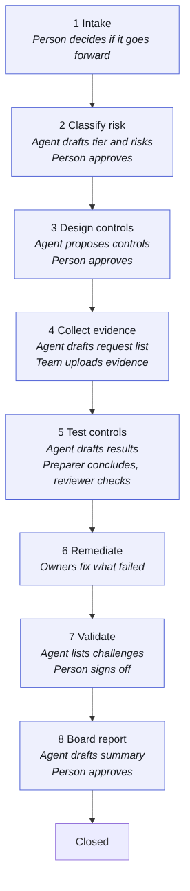

# What it is

**ARGUS** is the Assurance, Risk & Governance Unified System: an AI-powered workbench for assurance teams. AI agents draft the work at every step, named people decide, and every action is recorded so it can be proven afterwards. It is named for Argus, the hundred-eyed watchman of Greek myth, and the Great Argus pheasant whose wing carries rows of eye-spots; the logo is the pheasant in display.

## The problem

Organisations are putting AI to work in lending, customer service, claims, HR and back-office tasks. Boards, regulators and customers want to know that each use is understood, that its risks are managed, and that someone checked. Doing that well is a lot of careful, repetitive work:

- finding out which AI is in use and who owns it,
- judging how risky each use is,
- deciding which controls should be in place,
- collecting evidence and testing that the controls actually work,
- tracking what failed until it is fixed,
- and reporting all of it in a way a board can act on.

Spreadsheets and email make that slow, and make it hard to show later who decided what, and on what evidence.

## What the harness does

The ARGUS gives an assurance team one place to run that work for each client.

- **Every AI use case is a card on a board.** It moves through eight stages, from Intake to Board report.
- **AI agents draft the routine work.** They propose a risk tier, suggest controls from a library, list the evidence to ask for, draft test results, list challenges and draft the board summary.
- **People decide.** A named person approves at each decision point. Agents can never approve, conclude a test, accept a risk or sign anything off.
- **Everything is recorded.** Every action lands in an audit log that shows if it has been tampered with.

## Who uses it

| Person | What they do in the harness |
| --- | --- |
| Engagement lead | Sets up each client engagement, decides what's in scope, accepts risk above appetite, signs off the readiness report |
| Reviewer | Approves each stage, reviews tests someone else prepared, closes issues once retested |
| Preparer | Adds use cases, controls, tests, evidence and issues; does the testing |
| Viewer | Reads everything (useful for client stakeholders or quality reviewers) |
| Admin | Manages people, AI models and workspace settings |

## What it produces

- **An AI inventory**: every AI system, model, agent, dataset and vendor tool, with an owner.
- **A risk register**: each risk scored before and after controls, against the client's risk appetite.
- **A control register and Statement of Applicability**: which controls apply, why, and who owns them.
- **A traceability matrix**: from each legal or standard requirement to the control, test and evidence that meets it.
- **Test workpapers and an evidence vault**: what was tested, how, by whom, and the evidence, fingerprinted so it can't be swapped later.
- **An issues log**: what failed, who owns the fix, by when, and proof it was retested.
- **Evaluation and red-team results**: how the client's AI systems behave when tested and attacked.
- **A readiness report**: maturity across seven areas, top risks, open issues and approved summaries, ready to print or share.

## What it is not

- It doesn't replace professional judgement. It drafts; people decide.
- It doesn't connect to a client's systems yet. Evidence is uploaded by the team.
- It isn't a certification. It helps a team assess readiness against standards such as ISO/IEC 42001 and the NIST AI Risk Management Framework, and shows its working.
