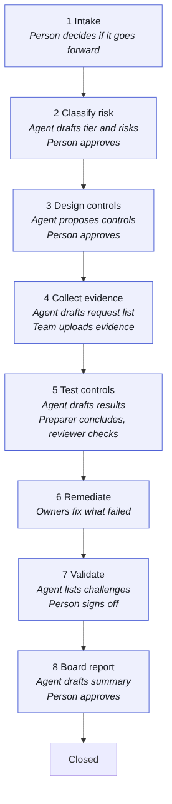
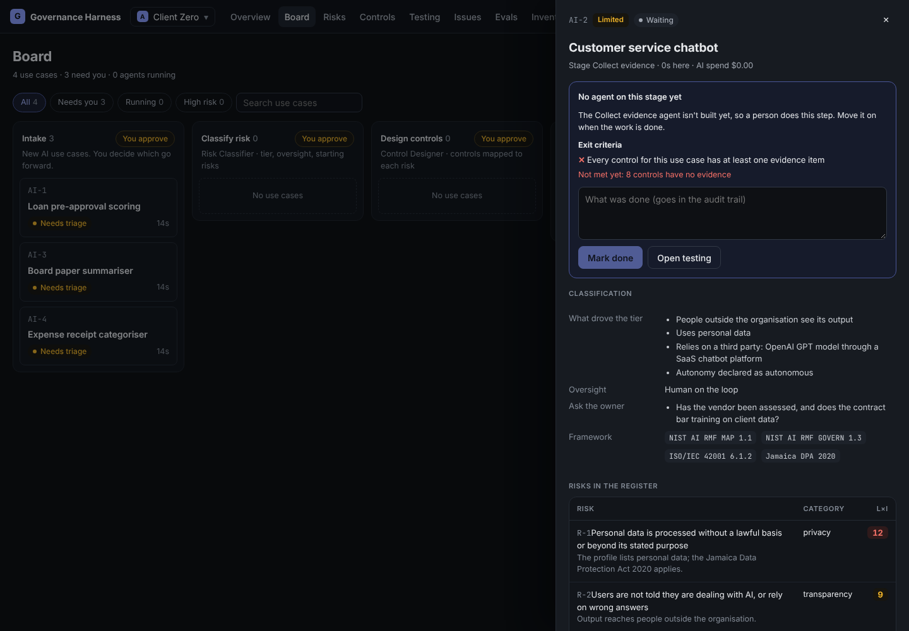
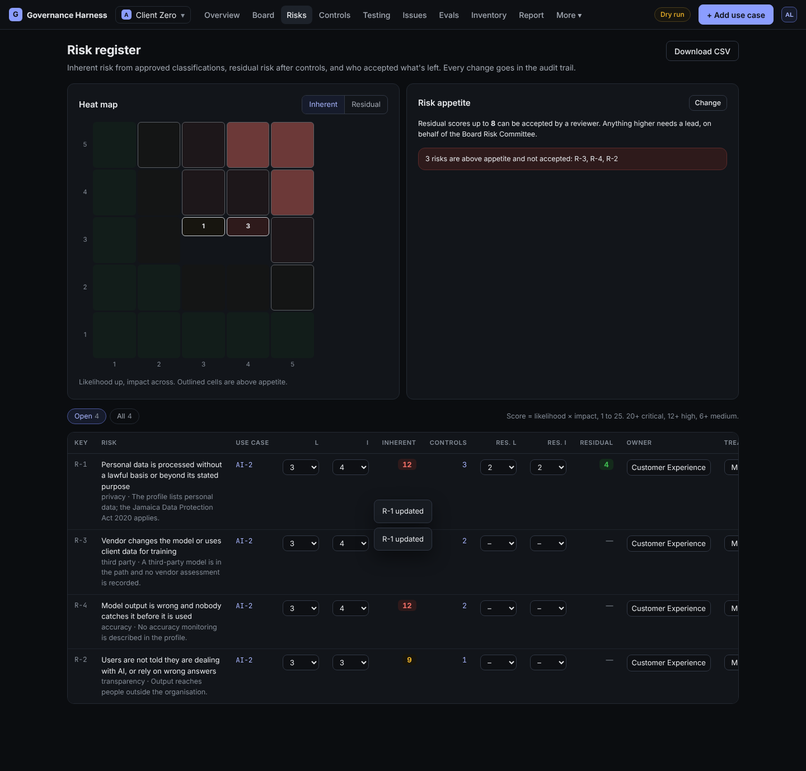
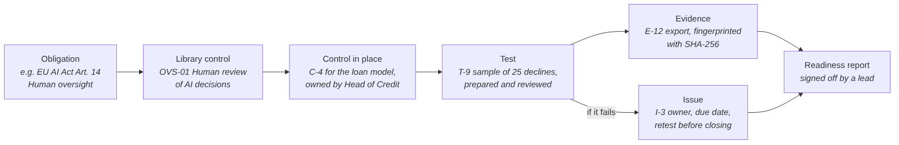
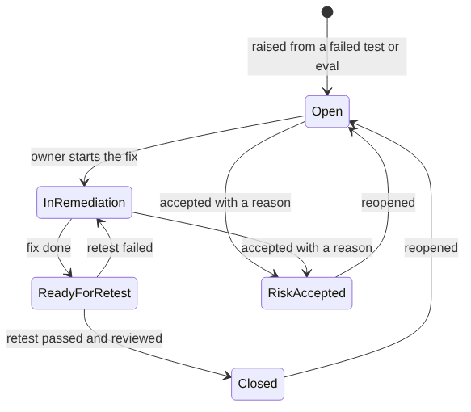

# How it works

## Engagements

Work is organised into **engagements**. An engagement is one piece of work for one client, for example "AI governance readiness 2027 for Harbourview Credit Union". Each has its own use cases, risks, controls, tests, issues and report. You switch between engagements with the switcher at the top left.

## The journey of a use case

A **use case** is one way the client uses AI, such as "a chatbot that answers customer questions" or "a model that scores loan applications". Each one is a card that moves through eight stages:

| Stage | What happens | Who decides |
| --- | --- | --- |
| 1. Intake | Someone describes the use case: what it does, what data it uses, who it affects, how much it acts on its own | A reviewer or lead decides whether to take it forward. Not the person who added it |
| 2. Classify risk | The Risk Classifier agent proposes a risk tier (prohibited, high, limited or minimal), how much human oversight it needs, and its starting risks | A reviewer approves, or sends it back with a note |
| 3. Design controls | The Control Designer agent proposes controls from the library for each risk, with a test approach for each | A reviewer approves; the controls and a draft test for each go into the registers |
| 4. Collect evidence | The Evidence Collector agent drafts what to ask the client for. The team uploads evidence | It can't move on until every control has evidence |
| 5. Test controls | The Control Tester agent drafts a suggested result for each test. A preparer concludes each test; someone else reviews it | It can't move on until every test is concluded and reviewed, and every failed test has an issue |
| 6. Remediate | Control owners fix what failed | It can't move on while a critical or high issue is open |
| 7. Validate | The Review assistant lists challenges: weak evidence, thin samples, risks above appetite | A reviewer signs off, having weighed the challenges |
| 8. Board report | The Report Writer drafts a board summary using only the harness's figures | A reviewer approves the summary; only approved summaries go in the report |

## Gates and exit criteria

Two separate safeguards stop a use case moving on too early:

- A **gate** means a named person must act before the card leaves the stage. The lead chooses which stages have gates (Settings, Workflow & gates). Intake always has one.
- **Exit criteria** are checks the harness enforces whatever the gate settings: evidence for every control, every test concluded and reviewed, no serious issue left open. If they aren't met, the card can't move, and the panel says exactly what's missing.

Stages where an agent drafts (Evidence, Test, Validate, Report) always stop for a person after the agent has run, even without a gate.

## People and roles

| Role | Can |
| --- | --- |
| Admin | Everything, including people, AI models and workspace settings |
| Engagement lead | Engagement settings and gates, agents, accept any risk, sign off the report, add, archive and restore engagements |
| Reviewer | Approve stages, review tests, accept risks within appetite, close issues |
| Preparer | Add use cases, controls, tests, evidence and issues |
| Viewer | Read everything, change nothing |

On top of roles, the harness enforces **segregation of duties**:

- Nobody approves a use case they added.
- Nobody reviews a test they prepared.
- An issue raised from a test can't be closed until a retest passes and someone reviews it.
- Nobody signs off a readiness report whose areas they scored entirely themselves.
- If someone changes their display name, their old names stay attached to them, so a rename can't get around any of these.

## Risk: inherent, residual and appetite

Every risk gets a **likelihood** and an **impact** from 1 to 5. Multiplied, they give a score from 1 to 25 (20 and above is critical, 12 and above high, 6 and above medium).

- The **inherent** score is the risk before controls.
- The **residual** score is what's left after controls, set by the team.
- The **risk appetite** is the highest residual score the client accepts without escalating. A reviewer can accept a risk within appetite; above it, only a lead can, on behalf of the board committee named in the engagement.

## The chain of evidence

The harness links each requirement to the proof that it's met, so anyone can follow the thread:

The **traceability matrix** on the Controls page shows this chain for every obligation, and marks each one covered, partial or a gap.

## Issues

When a test or evaluation fails, an **issue** is raised. Issues work like software defects:

Each has a severity, an owner, a due date and a management response. Overdue issues are flagged. An issue raised from a test needs a passed, reviewed retest before anyone can close it. Accepting the risk instead needs someone with authority to do so, and a written reason.

## The readiness assessment

At the end, the lead scores the engagement in seven areas on a five-level maturity scale (1 Initial, 2 Repeatable, 3 Defined, 4 Managed, 5 Optimising):

1. Governance and accountability
2. Inventory and risk classification
3. Control design
4. Testing and validation
5. AI security
6. Data protection
7. Issue management and monitoring

The harness suggests a score for each area from what it can see, with its reasons. The person scoring decides and writes why. The report is then signed off by someone who didn't score every area.
