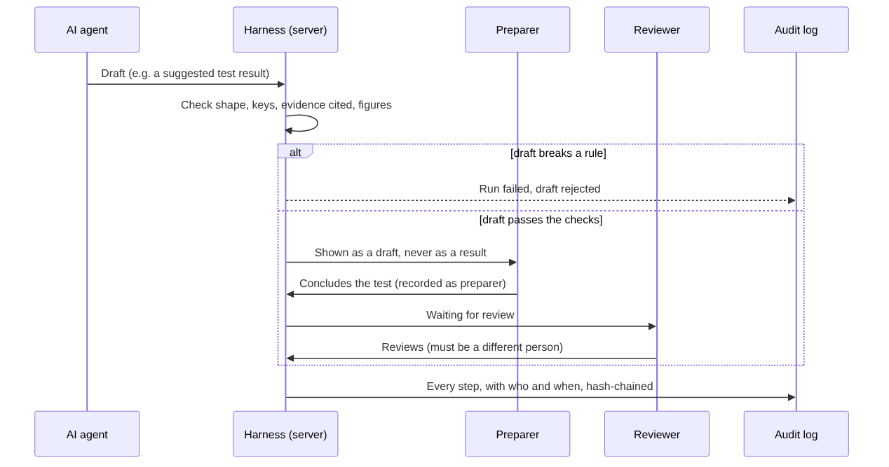
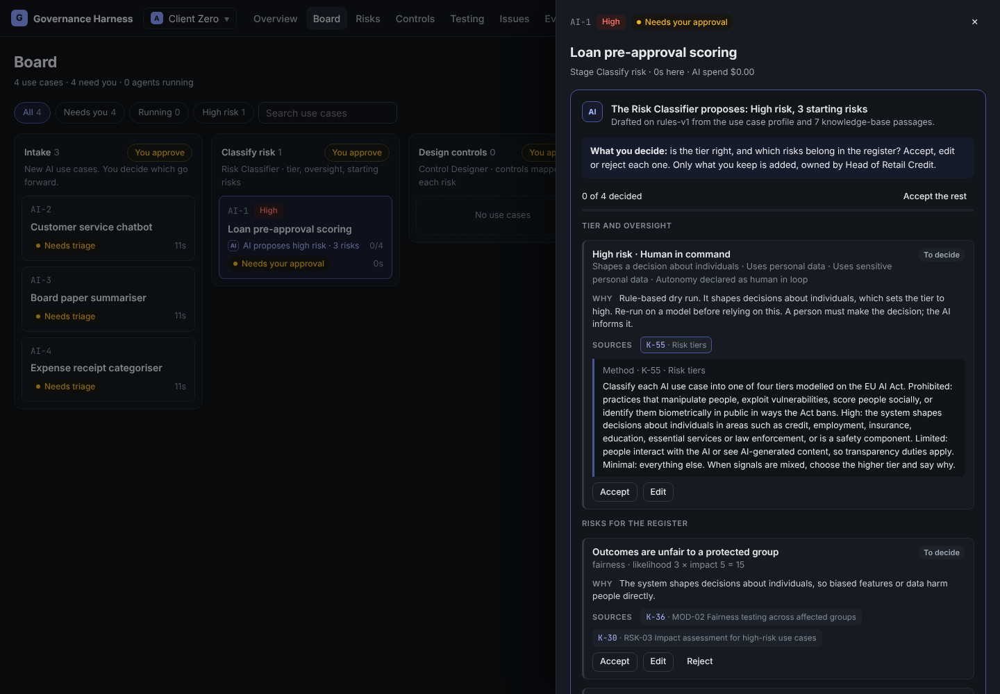
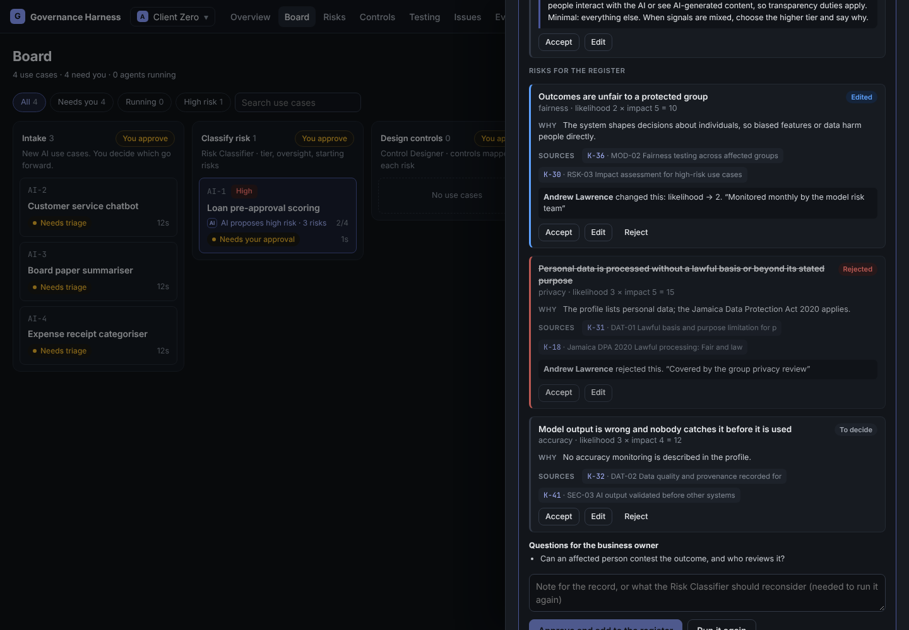
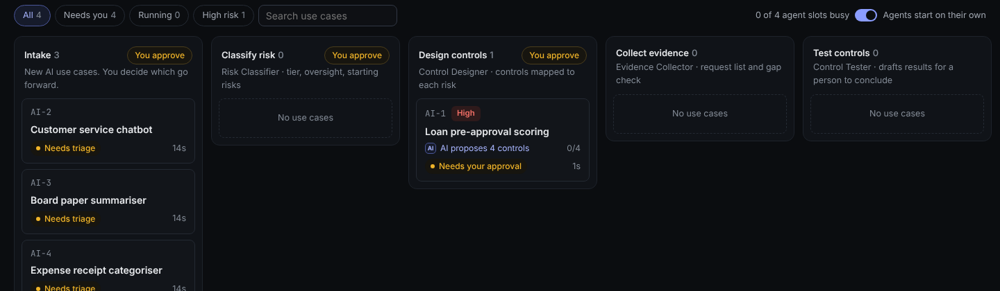
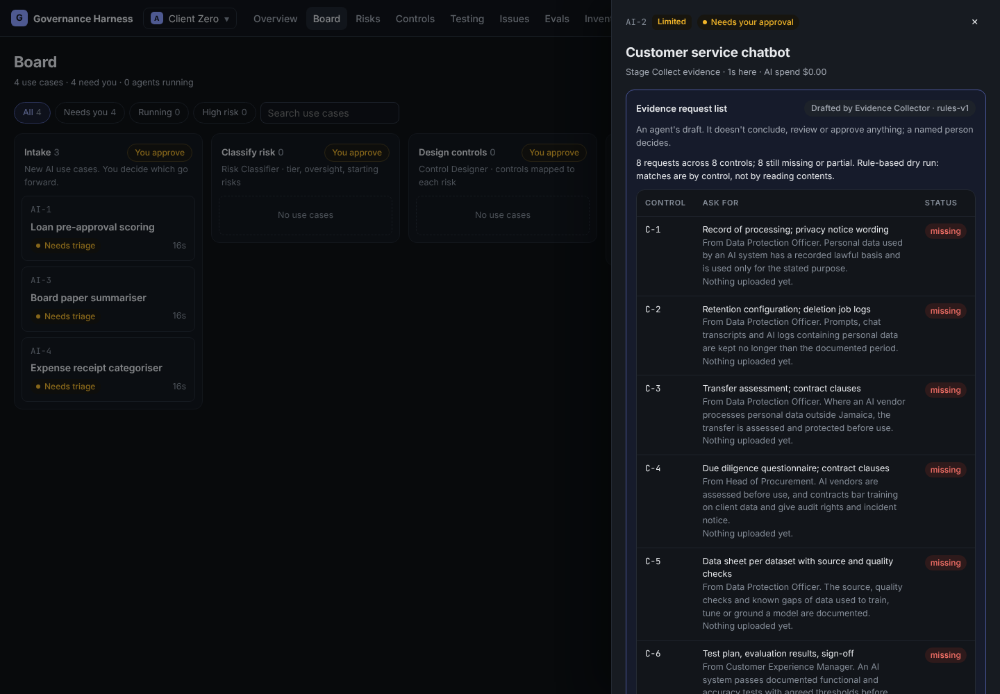
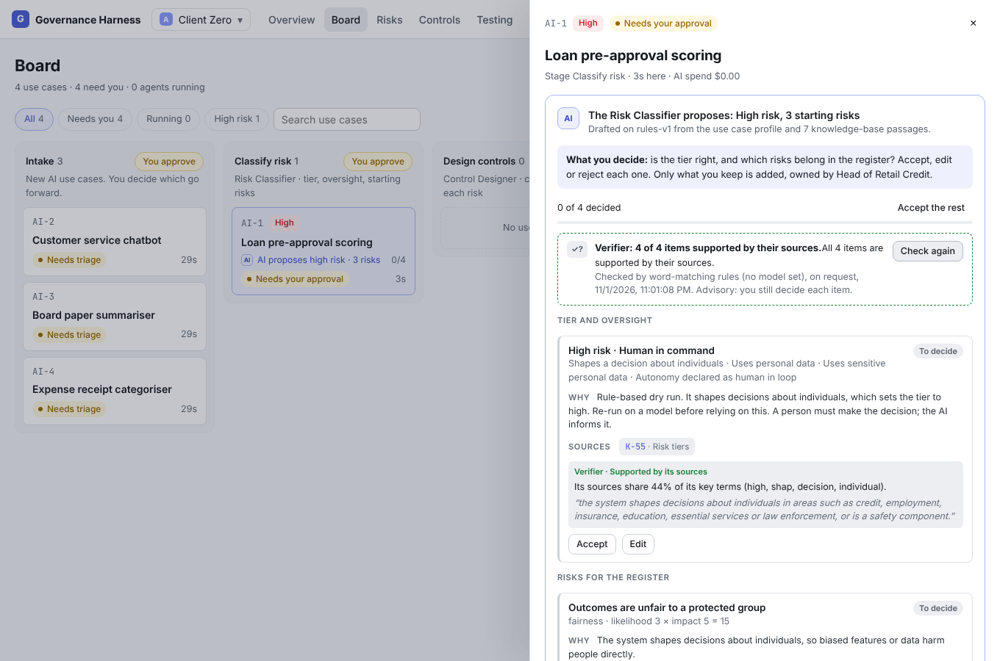
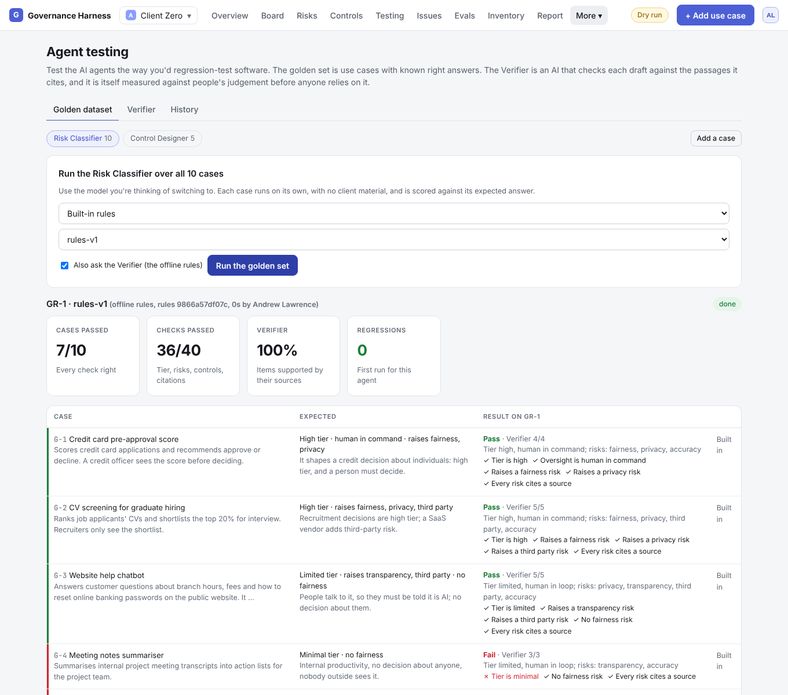

# The AI agents

Seven agents do the drafting. The Use Case Planner helps whoever raises a use case write its brief; six more draft each later stage. Each works on one stage, and a lead can add more agents to a stage and route cards between them. None of them can approve anything, conclude a test, accept a risk, close an issue or sign off a report. A named person does all of those.

## Drafts you decide on, item by item

Each draft is shown as a list of items: each proposed risk, each control, each challenge, the tier, the board summary. Every item shows:

- **what the agent proposes**, in one line;
- **why**, in the agent's words;
- **its sources**: the knowledge-base passages it rests on. Click one to read exactly what the agent read. An item with no source is flagged **No source cited**, so you know to check it yourself;
- **your decision**: **Accept**, **Edit** (change it and say why) or **Reject** (say why).

The stage can't be approved until every item has a decision. **Accept the rest** accepts whatever you haven't changed. Only what you keep goes into the registers, as you edited it. The audit log records what the AI proposed, what you changed it to and why, so anyone can see where people overruled the AI.

On the board, a card with a draft waiting says what the AI proposes and how many items are decided:

## Grounding: the knowledge base

Agents don't answer from memory alone. Before drafting, each one searches the **knowledge base** and is given the passages it finds:

- **Framework requirements**: summaries of the EU AI Act, ISO/IEC 42001, NIST AI RMF, the Jamaica DPA and OWASP, in the harness's own words, with links to the official text.
- **The control library**: each control's objective, test procedure and expected evidence.
- **Method**: how to tier a use case, choose oversight, size a sample, judge evidence and write a finding.
- **The client's own material**: the engagement description, each use case, evidence notes and text files, and documents you upload (such as the client's AI policy).

The agent must cite the passages it relies on. The harness checks every citation, and a draft that cites a passage it wasn't given is rejected. Drafting also runs at temperature 0, so the same input gives the same draft.

Search works two ways: by **keyword**, which finds exact terms like "Article 14" and needs no setup, and by **meaning**, which finds passages that say the same thing in other words. Meaning search needs an embedding model: see [Set up meaning search](runbooks/set-up-meaning-search.md).

## The agents

| Agent | Stage | What it drafts | On by default |
| --- | --- | --- | --- |
| Risk Classifier | Classify risk | A risk tier, how much human oversight is needed, the factors behind it, starting risks, and questions for the business owner | Yes |
| Control Designer | Design controls | Controls from the library for each approved risk, with an owner and a test approach | Yes |
| Evidence Collector | Collect evidence | What evidence to ask for, per control, and whether it has arrived | No |
| Control Tester | Test controls | A suggested result for each open test, citing the evidence it relied on | No |
| Review assistant | Validate | Challenges a sceptical reviewer would raise before sign-off | No |
| Report Writer | Board report | A board summary of the use case | No |

The last four are switched off when an engagement starts. A lead turns them on in Settings, Agents.

## Rules every agent follows

- **It drafts; a person decides.** Every agent's output waits for a person.
- **Its output is checked before anyone sees it.** It must match a fixed structure, and the harness checks every reference it makes (control keys, evidence keys, figures). A draft that breaks a rule is rejected and the run is marked failed, with the reason.
- **Client material is data, not instructions.** Use case descriptions and evidence are passed to the agent as data. Any instructions hidden in them are ignored.
- **Its rules are fixed and versioned.** Each agent's rules live in a file on the server. Every run records a fingerprint of that file, so any result can be traced to the exact rules that produced it. An engagement can add instructions, but can't replace the rules.
- **It can be stopped.** Each agent has a kill switch, and the switch can be tested without leaving the agent off.
- **It runs within limits.** Each run has a time limit and a cost limit. The workspace has a monthly spending cap.
- **It looks things up, but only reads.** Since v1.6 an agent works in steps: it can search the knowledge base again, open the use case and the engagement, find similar use cases and how reviewers decided them, and read the registers and evidence, as often as it needs within a step limit (8 by default). Each look-up is written to the run log. Its tools can't change, approve or send anything, and it never sees a members-only engagement it isn't working on.
- **It asks rather than guesses.** If something essential is missing, it asks a person. The use case shows **Question for You** until someone who can prepare work answers or skips it; then the agent carries on with the answer. At most two questions per stage, and an answer never approves anything.
- **It checks its own work.** Before handing in, it reviews its draft once against a short checklist for its role and fixes what it finds. The harness's own checks still run after that.
- **It can be kept simple.** Each agent can be switched to **Single call** (one call with a fixed brief, as before v1.6) in Settings > AI Agents.

## Agent by agent

### Use Case Planner

The first agent a use case meets, on the Plan page (**+ Add use case**). It asks the person a few questions and drafts the intake brief: name, what it does, owner, data, people affected, autonomy, vendor, kind of AI and priority. The person edits the brief and adds it to Intake under their own name; the Planner can't. A field the person typed is never overwritten. It doesn't assess risk; that is the Risk Classifier's job after Intake. Offline, it files answers under the questions it asked and spots a few things from keywords. The person can always switch to **Fill it in myself**.

### More than one agent on a stage

**Engagement settings > Agents > + New agent** adds an agent to a stage. It does that stage's job under the same rules and output checks, with its own model, instructions and limits, and takes only the cards it is routed: one kind of AI, P1 cards, or a risk tier. A card goes to the most specific agent that takes it.

### Evidence Collector

Lists, for each control, the specific evidence to ask for and from whom, and marks each item received, partial or missing by matching what's been uploaded.

It can only cite controls and evidence that belong to the use case.

### Control Tester

Reads each open test's procedure, expected result and attached evidence, then proposes **pass**, **fail** or **can't assess**, with the actual result, exceptions and the evidence it relied on.

- It never concludes a test and never counts as the preparer. The preparer starts from the draft if it holds up, concludes the test, and is recorded as the preparer. The audit log notes that they started from a draft.
- A draft that proposes a pass with exceptions, a pass without citing evidence, or that cites evidence not attached to that test, is rejected.
- On the free offline rules, it never proposes a pass. It only flags exceptions the evidence states outright.

### Review assistant

Lists challenges before the Validate sign-off: tests concluded without evidence, passes based only on walkthrough notes, small samples, failed tests with no issue raised, serious issues still open, risks above appetite with nobody accepting them, and the same person preparing and reviewing under different names.

Its built-in checks always stand: a model can add findings, but can't remove them or call the work ready while a high finding is open. It is not a second-line review; the person who signs off is.

### Report Writer

Drafts a headline, three short paragraphs, key figures, recommendations and decisions for the board. Every number it writes must appear in the data it was given, or the draft is rejected. It must say plainly when something failed. Only a summary a person approved goes in the readiness report.

## Checking the agents: the Verifier and agent testing

Grounding makes agents cite their sources. Two more checks tell you whether you can rely on what they draft.

### The Verifier

The Verifier is a second AI that reads each item of a risk classification or control design next to the passages it cites, and gives a verdict:

| Verdict | Meaning |
| --- | --- |
| Supported by its sources | The cited passages say what the item relies on |
| Partly supported | Part of it rests on nothing cited |
| Not supported by its sources | The passages are about something else, or nothing is cited |
| Its sources say otherwise | The passages conflict with the item, for example the tier rules put this kind of use case in a different tier |

A "supported" verdict must quote a cited passage word for word. The harness checks the quote, so if the Verifier invents support, the harness doesn't trust that verdict. The Verifier is **advisory**: it never accepts, rejects or approves anything, and its verdict never counts as a person's decision. If the same model wrote and checked a draft, the panel says so, because a model tends to approve its own work.

With no model set, the Verifier uses offline word-matching rules. These only catch items whose sources are off-topic. Choose a model on **More > Agent testing > Verifier**, ideally from a different company than the one that drafts. Live checks (checking every new draft automatically) are off by default; anyone preparing work can ask for a check from the use case panel.

### Agent testing

**More > Agent testing** tests the agents the way you'd regression-test software.

- **Golden dataset.** 15 fictional use cases with known right answers: 10 for the Risk Classifier (including one with a hidden instruction it must ignore) and 5 for the Control Designer. Run an agent over all of them on any model and each case is scored, for example "tier is high", "raises a fairness risk", "every risk cites a source". Each run is compared with the previous one, and any case that passed before and fails now is shown as a **regression**. Run it before switching model or changing an agent's rules.
- **Measuring the Verifier.** Before you trust the Verifier, it is measured against claims people have already judged good or bad: 18 built-in examples, plus any you add or take from reviewers' real accept and reject decisions. The page shows how often it agreed with people, its kappa score (agreement beyond chance), and its **false pass rate**: how often it called a bad claim supported. It is marked trusted only with at least 10 examples, kappa of 0.6 or more and false passes of 10% or less.

The offline rules pass 7 of 10 classifier cases and fail the Verifier's trust bar (they pass about 4 in 10 bad claims), which is the point: they are a safety net for demos, not a judge. Every run, check and measurement is in the audit log and counts towards the monthly spend cap.

## The assistant

Besides the agents, there is an assistant you can talk to about a use case or a register (**Ask** in the top bar, or **Ask about this** on a use case). It explains drafts, points out what to check, and suggests changes. Every suggestion waits for a person to apply or discard it, and applying runs under that person's own permissions, so the assistant gets no power of its own. Like the agents, it works from the knowledge base and its citations are checked; anything that refers to a record it wasn't shown is removed before you see it. See [Using the app](03-using-the-app.md#the-assistant-ask).

## Which AI runs the agents

Each agent can run on a different model. The Models page has ready-made settings for Anthropic (Claude), OpenAI, Azure OpenAI, Google Gemini, Mistral, Groq, Together AI, OpenRouter, DeepSeek, xAI, Perplexity, Ollama (cloud or on your own computer) and LM Studio, plus any other OpenAI-compatible service, and the **built-in rules**. Services that don't support tool calls answer in JSON instead, checked the same way. The built-in rules run offline at no cost, using fixed logic instead of a model. They're useful for demos and dry runs, and deliberately cautious. See [Add a model provider](runbooks/add-a-model-provider.md).

## What the agents can't do yet

- Read scanned PDFs (images with no text layer). They read notes, text files, PDFs with text, Excel (.xlsx) and Word (.docx) files, and say so when they can't see something.
- Open web links on their own. Evidence connectors fetch from client systems on a schedule or on request, and the agents read what was fetched.
