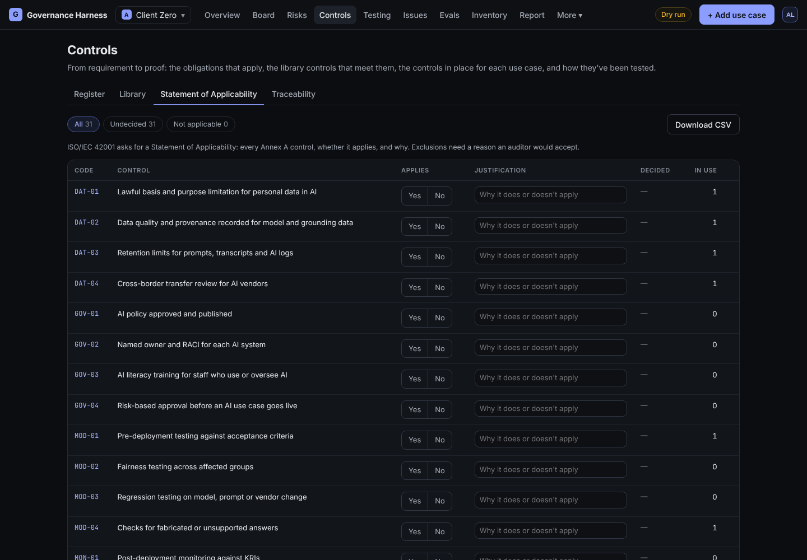
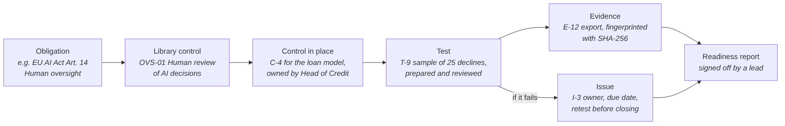

# Standards and controls

## The control library

The harness comes with 37 reusable controls in nine areas: governance and accountability, risk and impact assessment, data governance and privacy, model testing and validation, security, human oversight, transparency, third parties, and monitoring and incidents.

Each library control has:

- a code (for example OVS-01) and a title,
- its objective,
- its type (preventive, detective or corrective) and how often it operates,
- the evidence usually expected,
- a standard test procedure,
- the risk categories it treats,
- and references to the standards it helps meet.

## The frameworks it maps to

| Framework | What it is |
| --- | --- |
| NIST AI Risk Management Framework 1.0 | The US framework for managing AI risk: Govern, Map, Measure, Manage |
| ISO/IEC 42001:2023 | The international, certifiable standard for an AI management system |
| EU AI Act | European law on AI, with duties based on risk tier |
| Jamaica Data Protection Act 2020 | Rules for processing personal data of people in Jamaica |
| NIST Cybersecurity Framework 2.0 | Security controls around the AI |
| COSO Internal Control (2013) | The internal control framework used in audit and financial reporting |
| OWASP Top 10 for LLM applications and agentic AI | The most common ways AI chat systems and agents are attacked |

## Obligations

The harness also holds 23 **obligations**: specific requirements from these frameworks (for example "EU AI Act Article 14: human oversight"). Each is linked to the library controls that meet it.

## Statement of Applicability

ISO/IEC 42001 expects a **Statement of Applicability**: every control, whether it applies, and why. In the harness, each library control is marked applicable or not applicable for the engagement, with a justification and the name of the person who decided. When you add an engagement, the harness can start this list for you from the frameworks in scope; you then confirm or exclude each one.

## Traceability

The traceability matrix follows each obligation through to proof:

Each obligation is marked:

- **Covered**: a control is in place, tested, with evidence, and nothing failed.
- **Partial**: a control exists, but it lacks a test or evidence, or a test failed.
- **Gap**: no control in place.
- **Excluded**: every linked control is marked not applicable, with a reason.

## Adding your own controls

Leads can add controls to the library (with a code like GOV-07), and anyone preparing can add a control directly to a use case, starting from a library control or from scratch.
