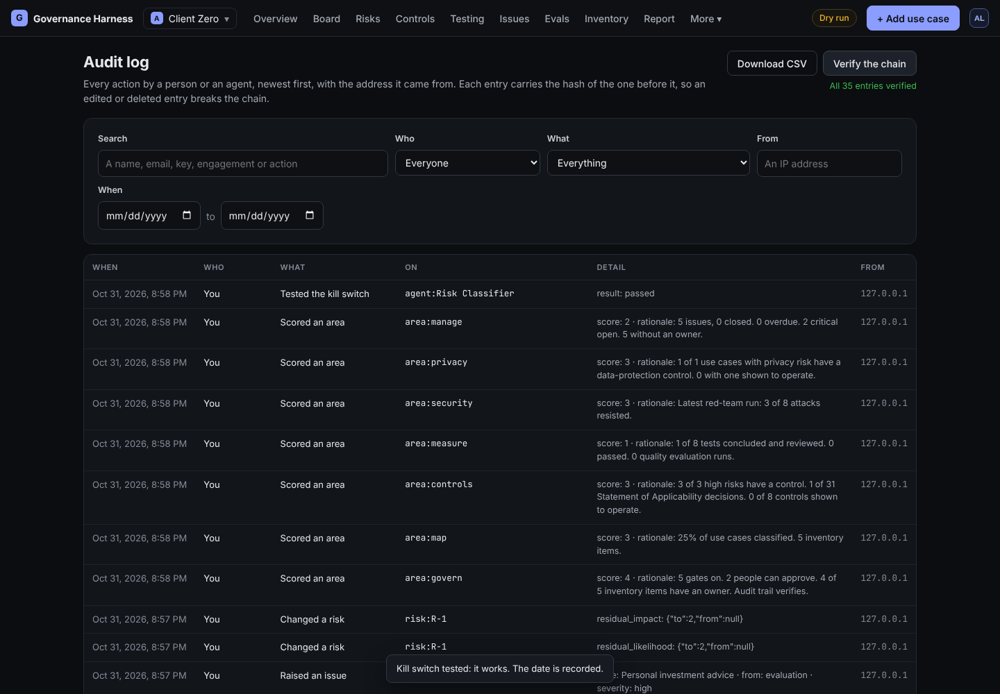

# How the harness governs itself

An AI governance tool that uses AI should meet the standard it checks others against. These are the controls built into the harness itself.

| Control | How it works |
| --- | --- |
| People approve, agents draft | No agent can approve, conclude, accept, close or sign off. See [The AI agents](04-ai-agents.md) |
| Segregation of duties | The person who added, prepared or scored something can't approve, review or sign it off. Old display names still count as the same person |
| Exit criteria | A use case can't leave a stage until its checks hold, whatever the gate settings |
| Sign-in and roles | Five roles with fixed permissions; passwords stored as one-way hashes; sessions end after 12 hours idle or 7 days |
| Tamper-evident audit log | Every action is recorded in the same database transaction as the change, with the address it came from. Each entry carries a fingerprint of the one before, so an edited or deleted entry breaks the chain. **Verify the chain** on the Audit log page checks it |
| Evidence fingerprints | Every evidence item is fingerprinted (SHA-256) when collected. **Verify** recomputes it to prove the evidence hasn't changed |
| Locked results | Once a test is reviewed, its result can't be edited. A retest is a new test |
| Versioned agent rules | Every agent run records a fingerprint of the rules it ran under |
| Kill switch | Each agent can be stopped at once; running work fails safely. The switch can be tested, and the date is recorded |
| Spending limits | A monthly cap on AI spend, with a warning level, plus a cost and time limit per run |
| Encrypted keys | AI provider keys are encrypted at rest, shown only as the last four characters, and never sent to the browser or to an agent |
| Read-only archives | An archived engagement can't be changed by anyone until it's restored |
| Deletion with a record | Only an admin can delete an engagement, only after archiving it, and only by typing its name. The audit log keeps who deleted it and what was removed |

## What is not done yet

- Single sign-on (for example Microsoft Entra ID) and multi-factor sign-in.
- A limit on repeated failed sign-in attempts. Put the app behind a proxy that has one before exposing it to the internet.
- Per-engagement membership. Today everyone signed in can see every engagement.
