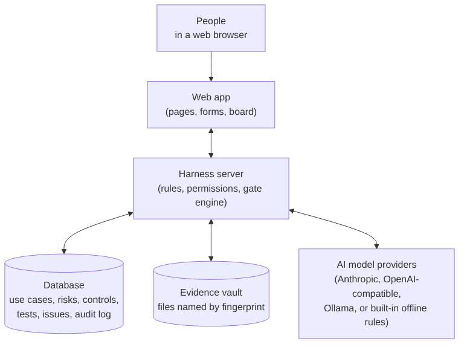

# Architecture

For IT staff and developers. Everyone else can skip this page.

| Part | What it is | Where |
| --- | --- | --- |
| Web app | Vue 3 single-page app, built with Vite | `apps/web` |
| Server | Node.js (Express 4) API, live updates over Socket.IO, and the gate engine that runs agents | `apps/server` |
| Shared model | Types, validation schemas, roles, stages and labels used by both | `packages/shared` |
| Database | Embedded Postgres (PGlite) in `data/pglite` by default, or any Postgres via `DATABASE_URL` | `data/` |
| Evidence vault | Files stored under `data/evidence`, each named by its SHA-256 fingerprint | `data/evidence` |
| Encryption key | Encrypts AI provider keys. From `SECRET_KEY`, or generated once into `data/secret.key` | `data/secret.key` |
| AI providers | Anthropic, OpenAI-compatible, Ollama, or the built-in offline rules | Configured on the Models page |

## How a request flows

1. The browser calls the server's API with a session cookie.
2. The server checks the session, the person's role and, for archived engagements, that the change is allowed.
3. The change and its audit entry are written in one database transaction.
4. The server pushes a small event to every open browser so pages update.

## How an agent run flows

1. Every 1.5 seconds the engine looks for use cases waiting in a stage that has an enabled agent.
2. It checks limits (four runs at once overall, per-agent and per-provider limits, the monthly spending cap).
3. It runs the agent on its chosen model, or on the fallback model if the first fails.
4. The agent's output is validated. If it passes, it's stored as a draft and the use case waits for a person. If not, the run fails with the reason.
5. Every step is logged on the run's page.

## Ports

| Port | What |
| --- | --- |
| 5173 | Web app in development (`npm run dev`) |
| 4300 | Server API; also serves the built web app in production (`npm start`) |

## Environment settings (`.env`)

| Setting | Use |
| --- | --- |
| `ANTHROPIC_API_KEY` | Optional. Used by the Anthropic provider if it has no key of its own |
| `DATABASE_URL` | Optional. Use a real Postgres instead of the embedded one |
| `SECRET_KEY` | 64 hex characters. Set from a secrets manager in production |
| `COOKIE_SECURE` | `true` behind HTTPS |
| `TRUST_PROXY` | `true` behind a reverse proxy, so the audit log records real client addresses |
| `PORT` | Server port (default 4300) |

## Project layout

See `CLAUDE.md` at the project root for the file-by-file map, and `README.md` for the full API list.
