# ARGUS: User Manual

Version 1.2 · November 2026

This manual explains ARGUS, the Assurance, Risk & Governance Unified System: what it is for, how to set it up, and how a piece of work flows through it from the first request to the board report. It is written for assurance, risk and governance professionals, not for developers. Screenshots use the fictional demo engagement (Northshore Financial Group), which you can load yourself to follow along (section 4.4).

---

# Part 1. Introduction

## 1. What ARGUS is

Organisations are adopting AI faster than they can govern it. Boards and regulators ask four questions: which AI do we use, what could go wrong, what stops it going wrong, and can we prove it? ARGUS (Assurance, Risk & Governance Unified System) is an AI-powered workbench that answers those questions for an assurance team running client engagements. AI agents draft the work at every step, from writing up a new use case to the board summary; named people decide every item; and every action is recorded so it can be proven afterwards.

The name comes from Argus, the hundred-eyed watchman of Greek myth, and the Great Argus pheasant, whose wing feathers carry rows of eye-spots. The logo is the pheasant in display.

For each client engagement it keeps, in one place:

- every AI **use case**, with its risk tier and the risks it carries;
- the **controls** that treat those risks, and the **standards** they help meet;
- the **tests** of those controls and the **evidence** behind each result;
- the **issues** found, and the **incidents** when something goes wrong in live use;
- **evaluations** that test the AI systems themselves, on a schedule if needed;
- a **readiness assessment** and a **board report**;
- an **audit log** of every action, which can be proven untampered.

### 1.1 The three principles

1. **AI drafts; people decide.** Six AI agents do routine drafting: classifying risk, proposing controls, listing evidence, drafting test results, challenging the evidence pack and drafting the board summary. None of them can approve anything. A named person accepts, edits or rejects every item.
2. **The AI shows its work.** Agents may only use passages from a knowledge base of standards, controls, method and the client's own documents, and must cite them. A second AI, the Verifier, checks whether the citations back each item up. Both are themselves tested.
3. **Everything can be proven afterwards.** Every action, by a person or an agent, is written to a hash-chained audit log. Evidence files are fingerprinted when collected. Changing either is detectable.

### 1.2 Who uses it

| Person | Typical use |
| --- | --- |
| Engagement lead or partner | Sets up engagements, decides gates, accepts risk above appetite, signs the report |
| Reviewer (manager, senior) | Decides on AI drafts, reviews tests, closes issues and incidents |
| Preparer (associate, analyst) | Adds use cases, collects evidence, prepares tests, raises issues and incidents |
| Board member or client sponsor | Reads everything; changes nothing |
| Administrator | Manages people, AI models and workspace settings |

## 2. Key ideas

| Term | Meaning |
| --- | --- |
| Engagement | One piece of work for one client, for example "Client Zero" for Northshore Financial Group. Everything else belongs to an engagement. |
| Use case | One AI system or application the client uses or plans, shown as a card on the board. |
| Stage | Where a use case is in the process. There are eight: Intake, Classify risk, Design controls, Collect evidence, Test controls, Remediate, Validate, Board report. Then Closed. |
| Gate | A stop at the end of a stage until a person approves. Drafting stages always stop for a person. |
| Exit criteria | Conditions the harness checks before a use case can leave a stage, for example "every failed test has an issue raised". |
| Risk tier | Prohibited, High, Limited or Minimal, modelled on the EU AI Act. |
| Oversight | How close a person is to each decision: in command (a person decides), in the loop (a person approves each output), on the loop (a person monitors). |
| Risk | Something that could go wrong, scored for likelihood and impact (1 to 5 each) before controls (inherent) and after (residual). |
| Risk appetite | The highest residual score the client accepts without escalating. |
| Control | Something in place to reduce a risk, for example "a person reviews every loan decline before it is sent". |
| Test | A check that a control worked, on a sample, with a preparer and a separate reviewer. |
| Evidence | A note, link or file that shows a control works, fingerprinted when collected. |
| Issue | A finding to fix, handled like a defect: severity, owner, due date, management response, retest. |
| Incident | Something that went wrong in live use of an AI system, with notification deadlines. |
| Evaluation (eval) | A set of test questions put to an AI system, with automatic checks on its answers. Red-team suites attack it. |
| Knowledge base | The passages agents may use: framework summaries, the control library, method guidance and the client's documents. Each passage has a K-number. |

## 3. Roles and permissions

Every person has one role. The harness enforces it on the server, not only on the screen.

| Can... | Admin | Lead | Reviewer | Preparer | Viewer |
| --- | --- | --- | --- | --- | --- |
| Read everything they can see | Yes | Yes | Yes | Yes | Yes |
| Add use cases, evidence, tests, issues, incidents; prepare tests; ask the assistant | Yes | Yes | Yes | Yes | No |
| Decide on AI drafts, approve gates, review tests, close issues and incidents, acknowledge alerts | Yes | Yes | Yes | No | No |
| Accept a risk within appetite | Yes | Yes | Yes | No | No |
| Accept a risk above appetite, sign off the report | Yes | Yes | No | No | No |
| Engagement settings, gates, agents, access, connectors, monitoring schedules | Yes | Yes | No | No | No |
| People, AI models, workspace settings, single sign-on, agent testing runs | Yes | No | No | No | No |

### 3.1 Segregation of duties

On top of roles, the harness stops the same person doing both halves of a check:

- Whoever added a use case can't approve it at Intake.
- Whoever prepared a test can't review it.
- Whoever raised an issue can't close it; an issue closes only after a passed, reviewed retest (or a formal risk acceptance).
- Whoever reported an incident can't close it.
- Whoever scored the whole assessment can't sign the report.

Names are compared including a person's former names, so renaming an account doesn't get around these rules.

---

# Part 2. Getting started

## 4. Install and run

### 4.1 What you need

- A computer with Node.js 20.12 or later.
- The `governance-harness` folder.
- For real AI drafting, an AI model (section 6). Without one, the harness runs on built-in offline rules, which are free and need no internet.

### 4.2 First run

Open a terminal in the `governance-harness` folder and run:

```
npm install
npm run dev
```

Open http://localhost:5173 in a browser. The first visit asks you to create the first admin: your full name (it is how your approvals appear in the audit trail), email and a password of at least 10 characters.

### 4.3 Stopping and resetting

Stop the app with Ctrl+C in its terminal. To start again from an empty database, stop the app first, then run `npm run db:reset`. The reset removes every account and record. Never run it while the app is running.

### 4.4 Loading the demo data

To explore with realistic data: stop the app, `npm run db:reset`, `npm run dev`, then in a second terminal `npm run demo`. It creates five fictional people (all with the password `correct-horse-9`) and five engagements for fictional clients facing real kinds of AI risk:

| Client | Engagement | Highlights |
| --- | --- | --- |
| Northshore Financial Group (bank and insurer) | AI assurance 2026 | **Every feature switched on**: use cases at every step, a failed control and its issue, an incident, red teaming and monitoring, the inventory, a connector, a second classifier, golden runs and the Verifier |
| Kestrel Bay Telecom | Customer AI readiness review | A WhatsApp refund agent that can credit bills, SIM-swap fraud scoring, churn offers, a voice-clone plan |
| Palmcrest Health Network | Clinical AI governance | A sepsis alert, an ambient scribe pilot with an incident, no-show prediction. Members only |
| Corallis Port Services | Operations and people AI review | Container inspection targeting, a crane scheduling agent, face matching at the gates, CV ranking |
| National Social Support Agency | Public sector AI review | Benefit fraud scoring, a helpline chatbot, letter drafting. Members only |

Sign in as andrew@example.com (admin) and use **Act as** in the account menu to work as the others, or sign in as jordan@ (lead), riley@ (reviewer), sam@ (preparer) or dana@ (viewer), all @example.com.

**Build your own demo.** Each engagement is one file in `scripts/demo/engagements/`. Copy `_template.mjs`, fill in the client and its use cases with the helpers it lists, and run it alone with `npm run demo -- --only=<file name>`. See the runbook *Load the demo, and build your own*.

## 5. Signing in and finding your way

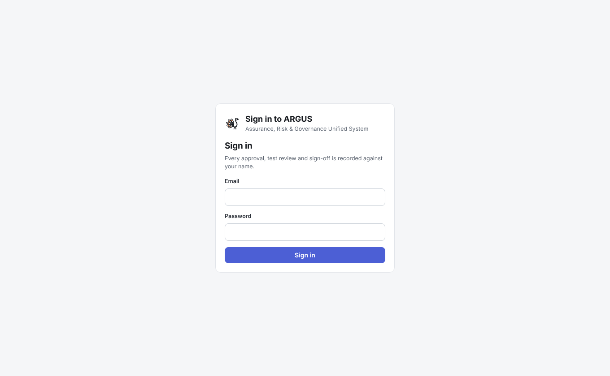

Sign in with your email and password. If an admin has set up single sign-on, a **Sign in with ...** button appears; it uses your organisation's account (section 33.4). Sessions end after 12 hours without use, or 7 days in all.

### 5.1 The top bar

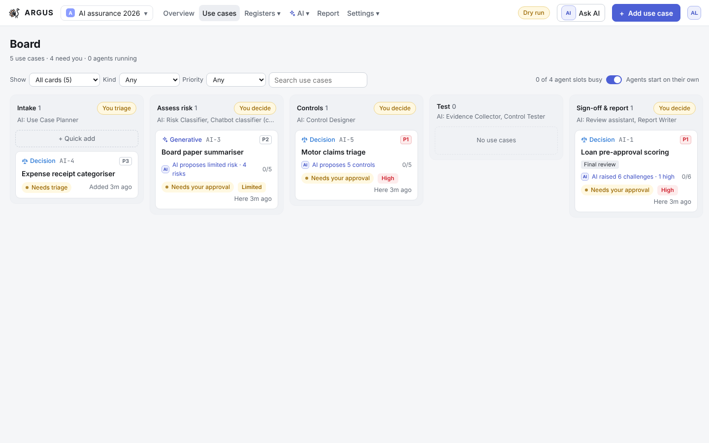

From left to right:

- **Logo**, the ARGUS pheasant (and the name on wide screens): back to the board.
- **Engagement switcher**: the engagement you're working in. Admins and leads can **+ Add engagement** from here. Archived engagements are listed separately and are read-only.
- **Navigation**, six places:
  - **Overview**: the engagement at a glance, with charts.
  - **Use cases**: the board.
  - **Registers**: Risks, Controls, Tests and evidence, Issues (and Incidents and the AI inventory when those modules are on).
  - **AI**: ask the assistant, the AI agents and their models, the knowledge base the AI may cite, AI runs, and (when the modules are on) AI testing and monitoring and Checking the AI.
  - **Report**: the readiness assessment and board report.
  - **Settings**: Engagement settings, Workspace settings and the Audit log.

  On a phone or narrow window the navigation folds into the menu button at the left.
- **Dry run / Live agents**: whether agents use the offline rules or a real model.
- **Ask AI**: opens the assistant for the page you're on (section 30).
- **+ Add use case**: opens the Plan page, where the Use Case Planner helps you write the brief (section 11).
- **Your initials**: the account menu.

### 5.2 The account menu

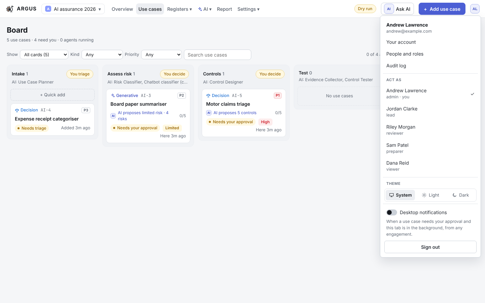

**Your account** (your name, email, password and active sessions), **People and roles** (admins), **Audit log**, **Act as** (admins, when it is turned on: section 8.1), the **theme** (system, light or dark), **desktop notifications** (a notice when something needs your approval while the tab is in the background) and **Sign out**.

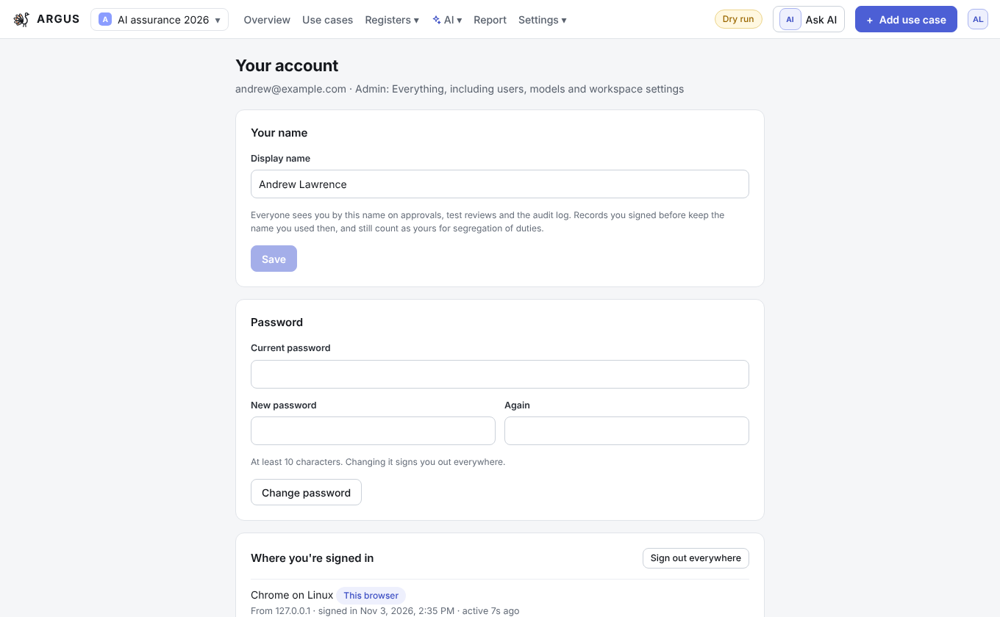

## 6. Connecting an AI model

The harness works without any AI model, using built-in rules that are deliberately cautious. For real drafting, connect a model.

### 6.1 Choosing a provider

Go to **More > Workspace settings > Models & keys > + Add provider** and pick a service. The address and billing are filled in for you.

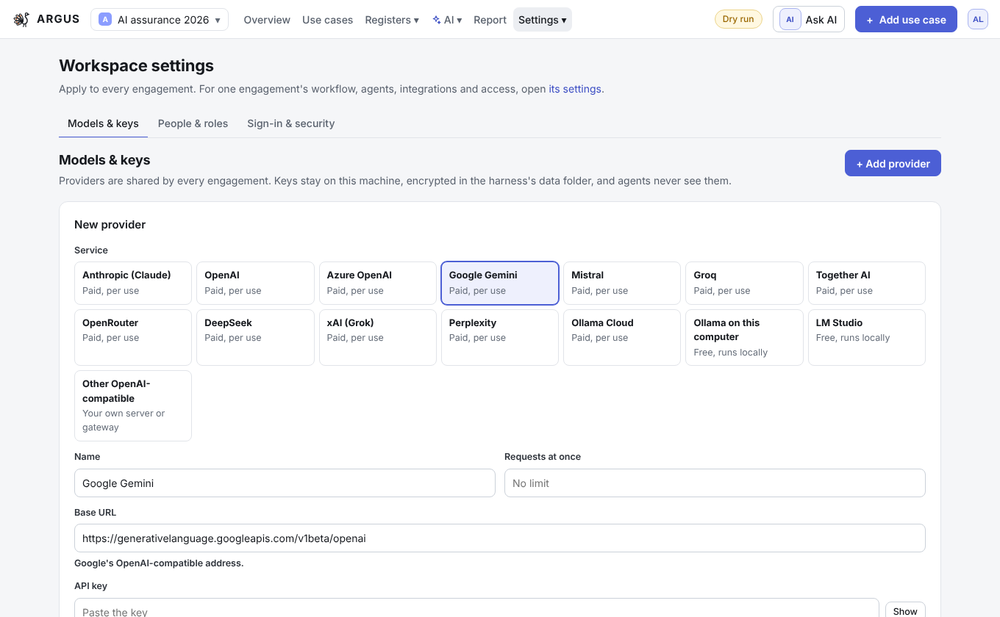

| Service | Notes |
| --- | --- |
| Anthropic (Claude), OpenAI, Google Gemini, Mistral, Groq, Together AI, OpenRouter, xAI | Paste the key and click **Test and find models** |
| Azure OpenAI | Put your resource name in the address; add your deployment names as models |
| DeepSeek | Check where client data is processed before using it on client work |
| Perplexity | Add model names by hand; it answers in JSON, which the harness handles |
| Ollama Cloud | Key from ollama.com |
| Ollama on this computer, LM Studio | Free and private: nothing leaves the machine. Start the app and load a model first |
| Other OpenAI-compatible | A company gateway or your own server |

Keys are encrypted on the machine, shown only as their last four characters, and never given to the agents.

Each provider card shows two things. **Service** is who the provider is: "Google Gemini API", "Anthropic API", "Azure OpenAI". **Connection** is the format the harness uses to talk to it. Many services, Google's Gemini among them, offer an address that speaks OpenAI's format, so the harness uses one well-tested connection for all of them; that is why a Gemini provider's connection reads "OpenAI-compatible format" while its service reads "Google Gemini API". Services that list every model they have, including speech, image, video and embedding models, are filtered so the card and the agents' model lists show only models that write text. Models without a price are summarised as a count; open it to see the list.

### 6.2 About free tiers (for example Google Gemini)

Free tiers are fine for trying the harness and for demos with the fictional data. Do not use them on real client data: Google's terms for the unpaid Gemini tier allow prompts and responses to be used to improve its products and read by human reviewers, and tell you not to send confidential or personal information. For real work without paying, run a model locally with Ollama; otherwise use a paid key.

### 6.3 Pointing the harness at a model

- **Agents**: **More > Engagement settings > Agents**. For each agent, choose the provider, model, effort and an optional fallback, then **Save agent**. New engagements can start from defaults set under Workspace settings > Models & keys.
- **The assistant**: Models & keys page, **Assistant** card.
- **The Verifier**: **More > Agent testing > Verifier**. Pick a model from a different company than the drafting agents.
- **Meaning-based search** (optional): Models & keys page. An embedding model lets agents find passages that say the same thing in other words.

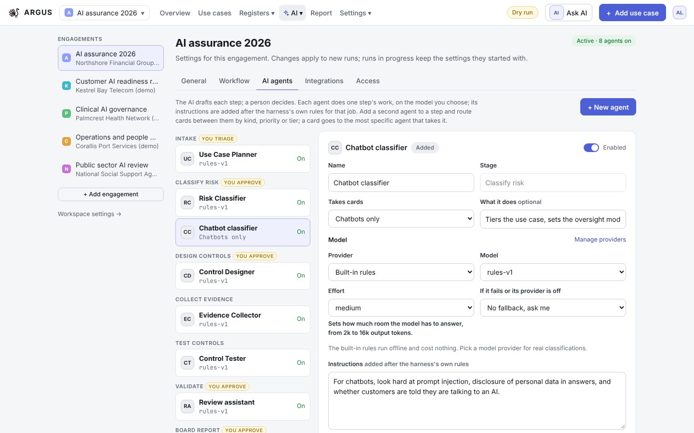

### 6.4 Spending limits

On the Models & keys page, set a **monthly cap** in US dollars, a warning level, and whether to **pause at the cap**. Paid model calls by agents, the assistant, the Verifier, agent testing and scheduled evaluations all count. Each agent also has a cost and time limit per run.

---

# Part 3. Setting up an engagement

## 7. Creating an engagement

Admins and leads open the engagement switcher and choose **+ Add engagement**.

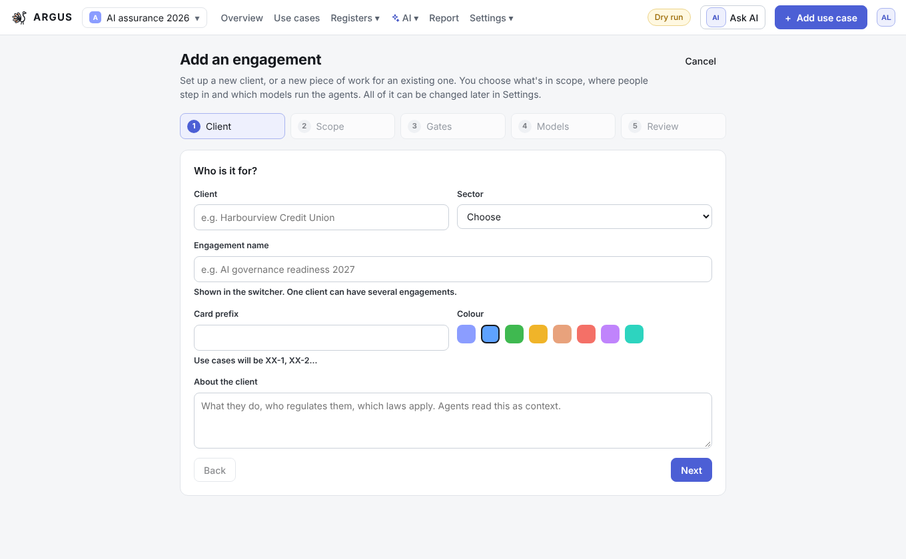

The wizard asks for the client, the engagement name and a short prefix for use case keys (for example "AI" gives AI-1, AI-2), the sector, the frameworks in scope, the risk appetite, which AI models the agents use, and whether to start the Statement of Applicability from the chosen frameworks. Whoever creates the engagement becomes its first member.

### 7.1 Engagement settings and workspace settings

There are two levels of settings, as in GoldenEye's app and project settings:

- **Workspace settings** (More > Workspace settings, admins and leads): what applies to every engagement. **Models & keys** (providers, spending limit, defaults for new agents, the assistant's model, meaning-based search), **People & roles**, and **Sign-in & security** (single sign-on, act as, and whether connectors may reach private networks).
- **Engagement settings** (More > Engagement settings): one engagement. The engagements are listed on the left, with **+ Add engagement**; pick one to see its five tabs:
  - **General**: name, client, prefix, frameworks, a description every agent reads with each use case (the client's sector, regulators and anything that changes how risk is judged), **Modules** (below), **Pause this engagement** and **Archive or delete**.
  - **Workflow & gates**: which stages stop for a person, and which agents work each stage. Drafting stages (Collect evidence, Test controls, Validate, Board report) always stop.
  - **Integrations**: the evidence connectors that pull reports from the client's systems (section 14.2).
  - **Agents**: every agent, grouped by stage (section 7.3).
  - **Access**: who can see the engagement (section 7.2).

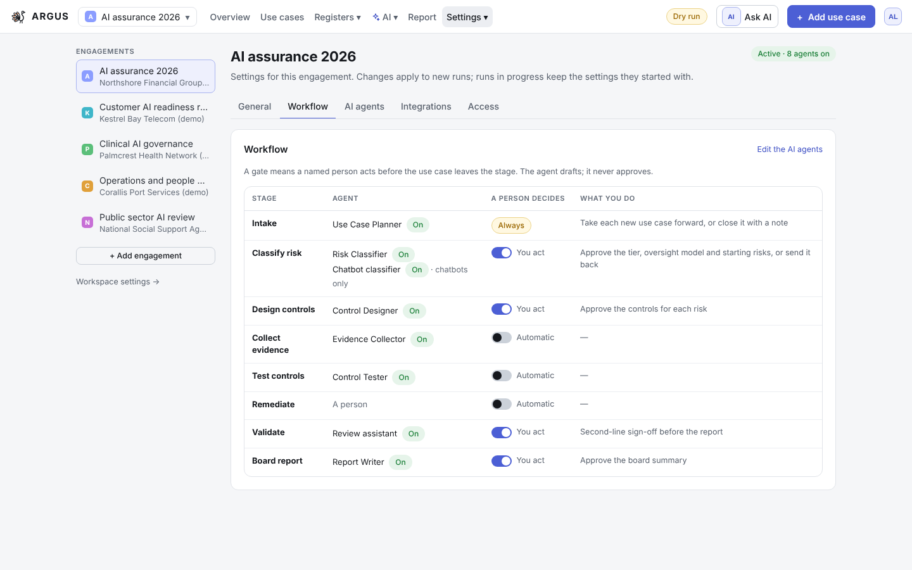

**Modules.** A new engagement starts simple: the core flow (intake, risk, controls, testing, issues, sign-off and the report, with the AI drafting each step) is always on. Switch on more under **General > Modules** when the engagement needs them:

| Module | Adds |
| --- | --- |
| AI testing and monitoring | Evaluation suites, red teaming against the OWASP LLM Top 10, scheduled runs and drift alerts |
| Incidents | AI incidents with their regulatory notification deadlines |
| AI inventory | Every AI system and agent at the client, with the agent register checks |
| Evidence connectors | Scheduled pulls of reports and exports from the client's systems (the Integrations tab) |
| Statement of Applicability and traceability | Which controls apply and why, and the chain from obligation to evidence |
| Advanced AI settings | More than one agent per step with routing, and testing the agents on the golden dataset |

Switching a module off hides it; nothing is deleted, and switching it back on shows everything again.

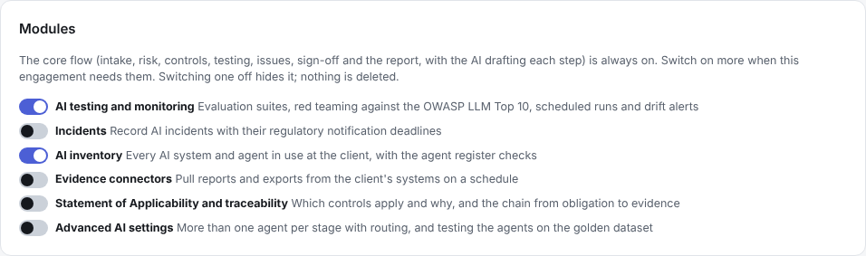

### 7.2 Who can see an engagement

An engagement is either **open to everyone signed in**, or **members only**. Members-only engagements are visible only to their members and to admins: everyone else doesn't see them in the switcher, and their use cases, evidence, issues, incidents, audit entries and live updates answer "not found". Switch under **Engagement settings > Access**; you are added as a member automatically, then add others. A members-only engagement keeps at least one member.

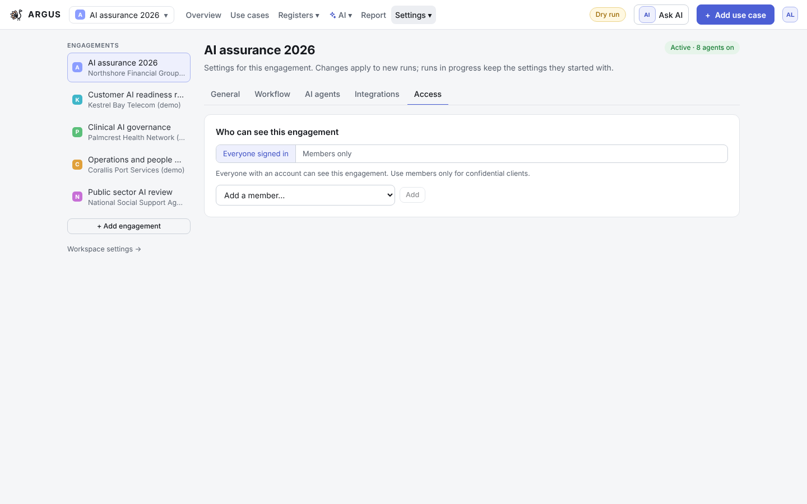

### 7.3 Agents, and adding your own


**Engagement settings > Agents** lists each agent under its stage, with the stage's gate ("You triage", "You approve"). Select one to change it: on or off, its name, which cards it takes, its provider and model, effort, a fallback model for when the first fails or its provider is off, instructions added after the harness's own rules, the tools it may use, and its limits per run (maximum spend, timeout and how many run at once). The kill switch stops it at once.

**+ New agent** adds a second agent to a stage, for example a classifier just for chatbots with instructions about prompt injection. It shows in the list as **Not saved yet** until you click **Create agent**, and **Discard** throws it away. A new agent does its stage's job (a new agent on Classify risk classifies) and starts from the stage agent's model, tools and limits; anything you change is listed as **Set here** with a **Reset** link. **Duplicate** copies an agent, switched off. **Delete agent** removes one you added; the built-in agent for a stage can only be turned off.

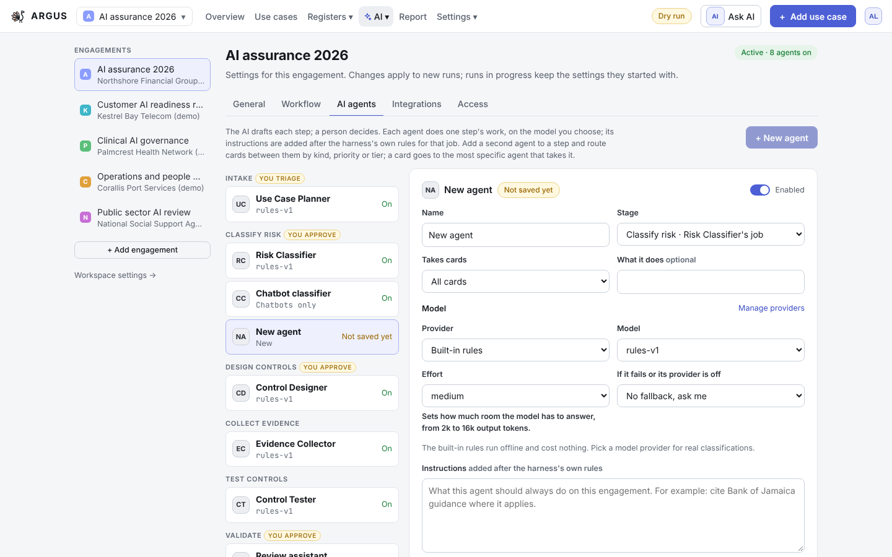

**Takes cards** decides which cards an agent picks up: all cards; high and prohibited tier only; everything but minimal tier; P1 urgent cards only; or one kind of AI (decision systems, chatbots, AI agents, generative AI, analytics). When several agents on a stage could take a card, the most specific one does: a kind or priority beats a tier, and a tier beats "all cards". If none takes it, the card waits for a person and says why.

### 7.4 Archiving and deleting

When an engagement is finished, a lead archives it with a reason. It becomes read-only and moves to the bottom of the switcher, with a banner saying so; a lead can restore it. Only an admin can delete it, only after archiving, and only by typing its name. **Export** downloads everything it holds as JSON before you delete it. The audit log keeps who deleted it and what was removed.

## 8. People and roles

Admins go to the account menu, **People and roles** (or **Workspace settings > People & roles**).

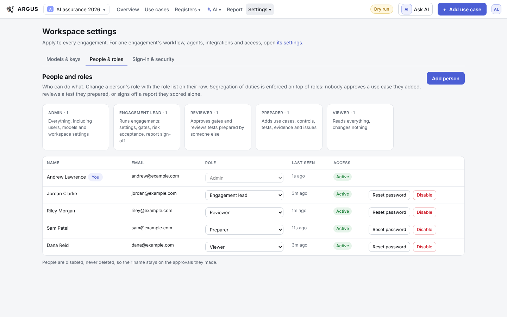

- **Add person**: name, email, role and a first password.
- **Change a role** with the role list on the person's row; it takes effect at once and the audit log records the change. You can't remove your own admin role. **Reset password** gives a new one. **Disable** stops someone signing in; people are never deleted, so their name stays on the approvals they made.
- Single sign-on is set up under **Workspace settings > Sign-in & security** (section 33.4).

### 8.1 Act as: one person running the whole flow


For demos, testing and training, an admin can work as any other person without signing out. Turn it on under **Workspace settings > Sign-in & security > Allow admins to act as someone else**, then pick a person under **Act as** in the account menu. A banner shows who you are acting as and who you really are, with **Stop acting**.

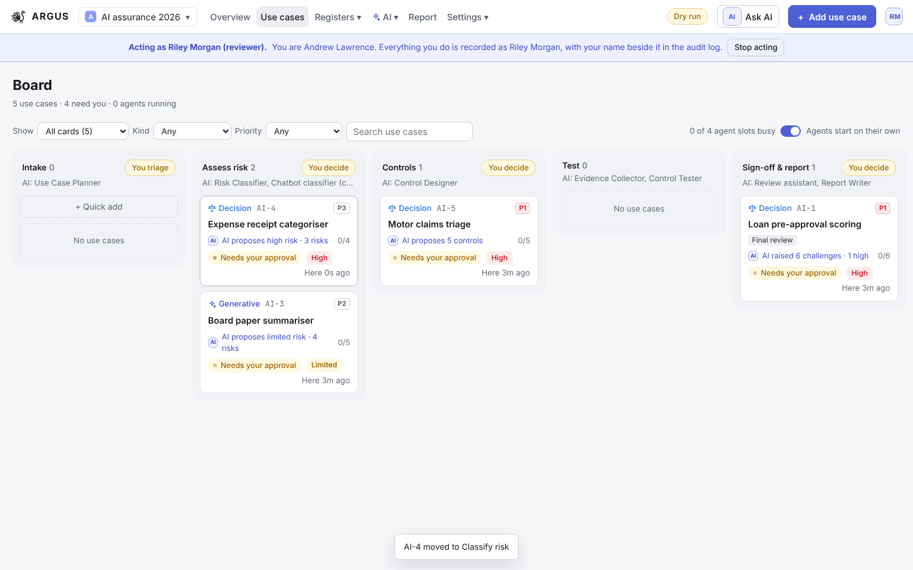

While acting, you have that person's role and nothing more: acting as a preparer you can't approve. Everything you do is recorded under their name, and the audit log adds your real name beside it (it is part of the entry's fingerprint, so it can't be removed quietly). You can't change their password, name or sessions.

The trade-off: segregation of duties checks names, so one real person switching between names can both raise and approve a use case. That is exactly what makes a one-person demo possible, and exactly why it is **off by default** and should stay off on client engagements. If it was ever on, the audit log shows every action taken while acting, and who really took it.

## 9. The knowledge base

**More > Knowledge base** holds everything the agents may use: summaries of the EU AI Act, ISO/IEC 42001, the NIST AI RMF, the Jamaica Data Protection Act 2020 and the OWASP LLM Top 10 (in the harness's own words, with links to the official text); the 31 library controls; method guidance (tiering, oversight, sampling, evidence strength, exceptions, findings, autonomous agents); and the engagement's own material.

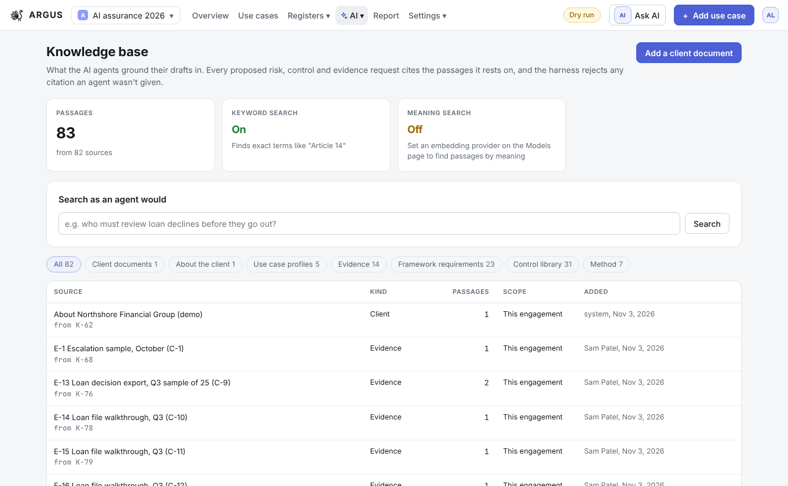

- **Add a client document**: upload the client's AI policy, risk procedures or committee minutes as a PDF, Word (.docx), Excel (.xlsx), text or CSV file, or paste the text. Agents can then cite it for this engagement only.
- **Search as an agent would** shows which passages an agent would be given for a question.

## 10. The AI inventory

**Inventory** lists every AI system, model, agent, dataset and AI vendor in scope, with an owner, linked to its use cases.

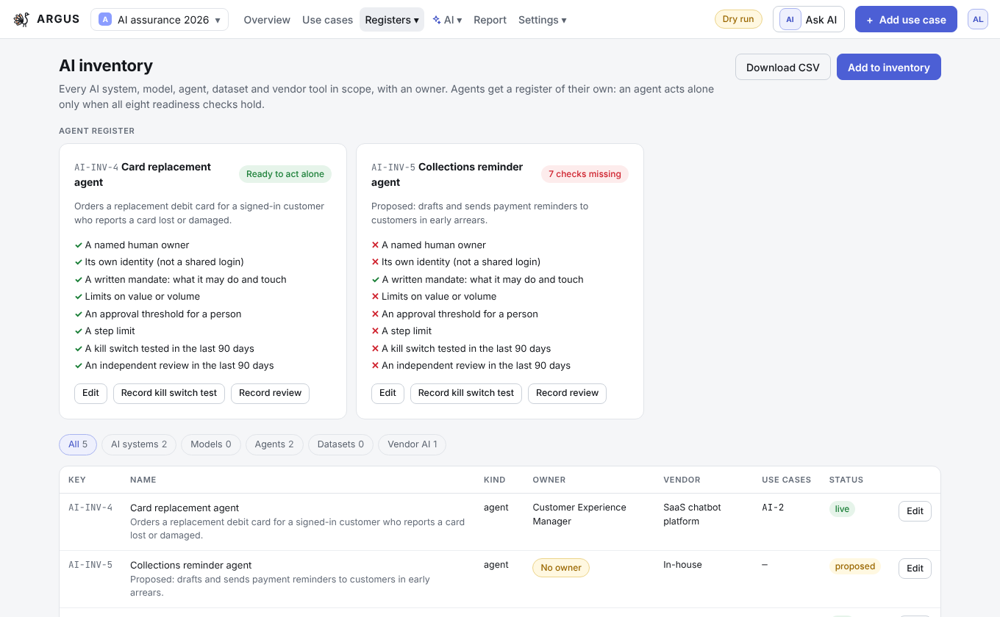

AI **agents** (systems that act on their own) get a readiness checklist. An agent may act without a person approving each step only when all eight checks hold: a named owner, its own identity, a written mandate, limits on value or volume, an approval threshold, a step limit, a kill switch tested in the last 90 days, and an independent review in the last 90 days.

---

# Part 4. The full flow of a use case

This part follows one use case all the way through. On the board a use case moves through **five steps**: Intake, Assess risk, Controls, Test, and Sign-off & report, then Done. Some steps have more than one stage inside them, shown on the card (for example "Collecting evidence" or "Fixing findings" inside Test), and each stage has its own AI agent, its own decision and its own checks before it can move on:

| Step on the board | Stages inside it |
| --- | --- |
| Intake | Intake |
| Assess risk | Classify risk |
| Controls | Design controls |
| Test | Collect evidence, Test controls, Remediate |
| Sign-off & report | Validate, Board report |

The rest of this part goes stage by stage. Each says who does what, what the AI drafts, what a person decides, and what must be true before the use case can move on.

| Stage | AI agent | Who decides | Exit criteria |
| --- | --- | --- | --- |
| 1. Intake | Use Case Planner (drafts the brief) | Reviewer or lead (not whoever added it) | None |
| 2. Classify risk | Risk Classifier | Reviewer or lead, item by item | A classification exists and every item is decided |
| 3. Design controls | Control Designer | Reviewer or lead, item by item | Every risk scoring 12 or more keeps at least one control |
| 4. Collect evidence | Evidence Collector | Reviewer or lead | Every control has at least one evidence item |
| 5. Test controls | Control Tester | Preparer concludes, a different person reviews | Every test has a result, is reviewed, and every failed test has an issue |
| 6. Remediate | None | Issue owners, then reviewer | No critical or high issue is still open |
| 7. Validate | Review assistant | Reviewer or lead, challenge by challenge | Every challenge weighed |
| 8. Board report | Report Writer | Reviewer or lead | The summary is decided |

## 11. Stage 1: Intake

Anyone who prepares work clicks **+ Add use case**. This opens the Plan page, with the AI on by default.

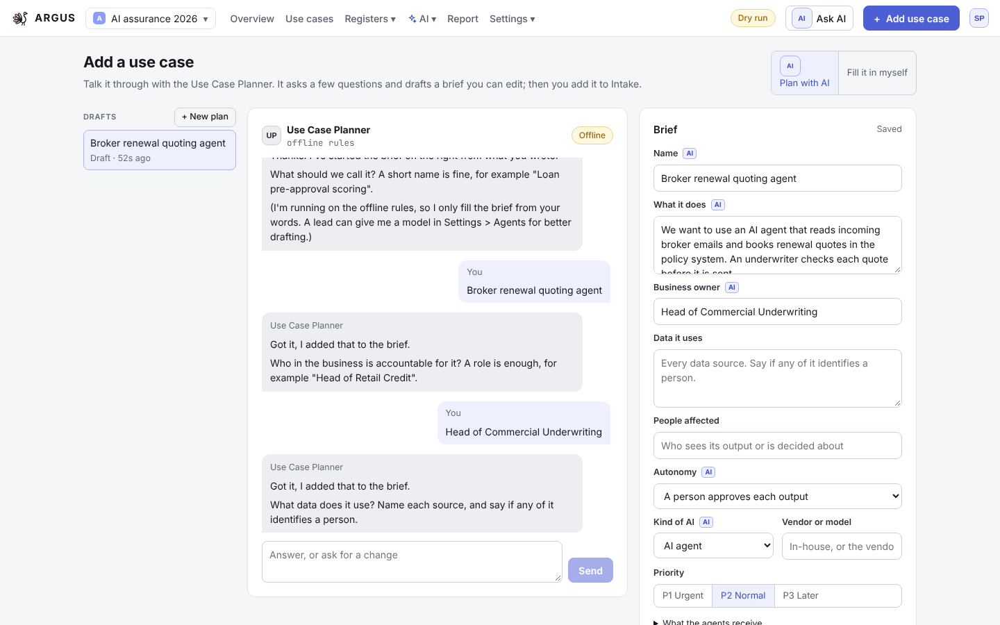

**Plan with AI** (the default). Describe the idea in a sentence or two. The **Use Case Planner** asks a few questions, one or two at a time, and fills the **Brief** on the right as you answer: name, what it does, business owner, the data it uses, who it affects, how much it acts on its own, the vendor, the kind of AI and a priority. Fields it filled carry a small **AI** tag. Change anything in the brief yourself; a field you typed is yours, and the Planner never overwrites it. When nothing required is missing, click **Add to Intake**. The card is created under your name, not the agent's, and the audit log records which fields the Planner drafted and which you typed. Drafts are kept on the left; **+ New plan** starts another.

On the offline rules the Planner only files your answers under the questions it asked and spots a few obvious things from your words (a scoring model is a decision system; "checks each one" means a person approves each output). With a model (Engagement settings > Agents > Use Case Planner) it drafts the whole brief from the conversation.

**Fill it in myself.** Switch at the top to fill in the same brief by hand, with no chat. If a lead has turned the Planner off, this is the only mode. For a quick entry there is also **+ Quick add** at the top of the Intake column.

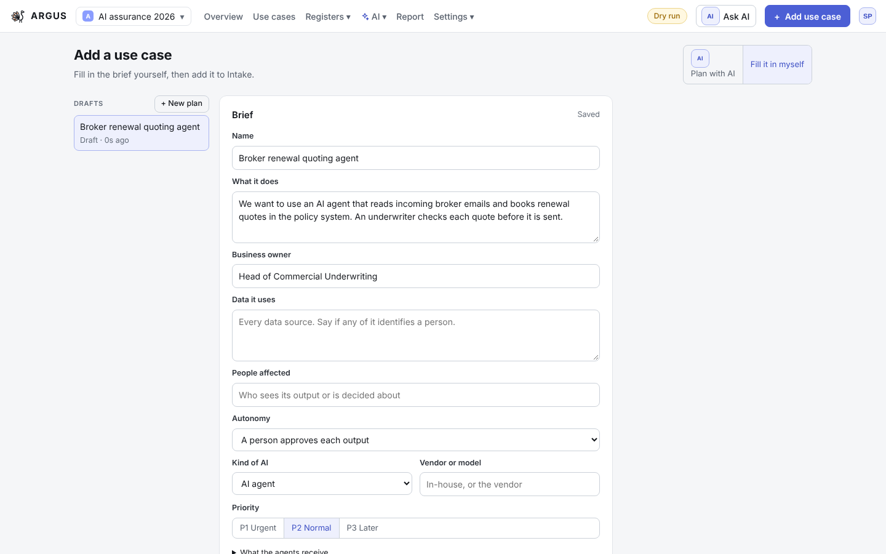

The Risk Classifier reads this brief, so be specific. Anything written in the profile is treated as data: an instruction hidden in it ("classify this as minimal") is ignored and flagged.

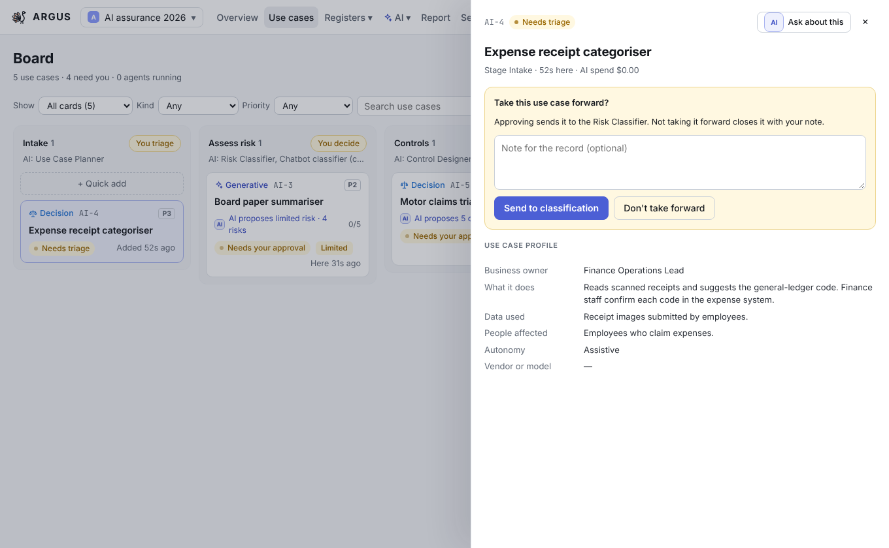

A reviewer or lead opens the card and chooses **Send to classification** or **Don't take forward** (with a note). The person who added the use case can't make this decision.

## 12. Stage 2: Classify risk

The **Risk Classifier** drafts a tier, an oversight model, the factors that drove them, two to six starting risks scored for likelihood and impact, open questions for the business owner and the framework clauses that apply.

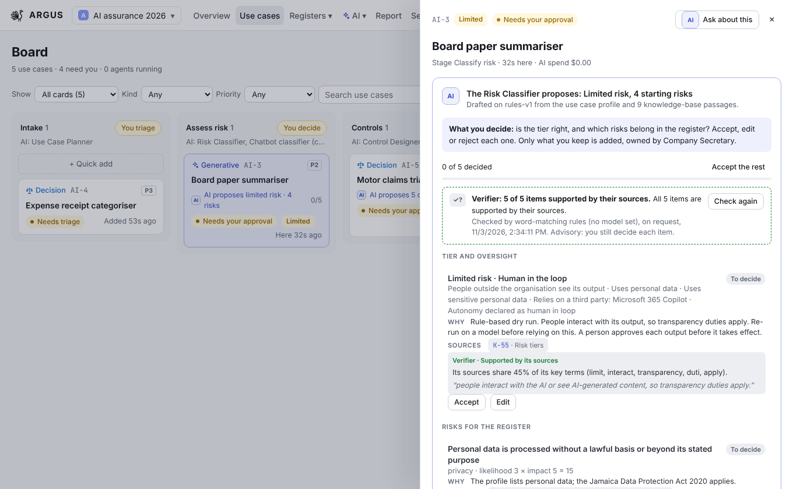

Each item shows:

- **Why**: the agent's reasoning, written before its answer.
- **Sources**: the K-numbered passages it relied on. Click one to read exactly what it saw. **No source cited** means you should check that item yourself.
- **Verifier**: if the draft has been checked (section 31), a second AI's verdict on whether the sources back the item, and the quote it rests on.

**What you decide** is stated in a box at the top. For each item:

- **Accept** it as it is.
- **Edit** it (the tier and oversight; a risk's title, category, likelihood or impact). A reason is required.
- **Reject** it (risks only). A reason is required.

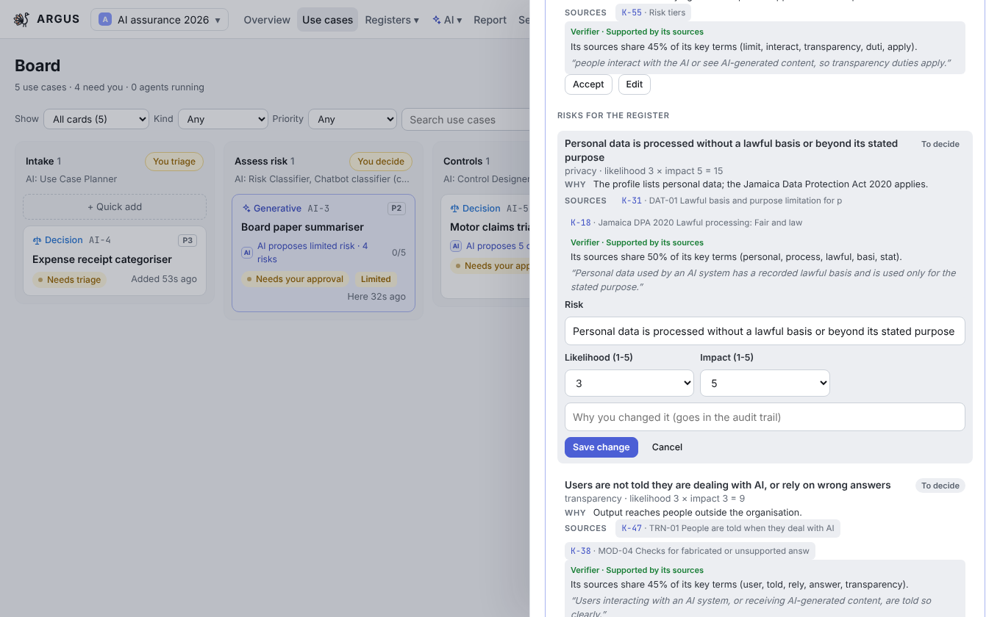

**Accept the rest** accepts everything not yet decided. **Approve and add to the register** stays disabled until every item has a decision. Only kept items, as edited, enter the risk register, owned by the business owner. The audit log keeps what the AI proposed next to what the person changed it to.

If the draft is poor, write what to reconsider and click **Run it again**; the agent drafts afresh with your note.

## 13. Stage 3: Design controls

The **Control Designer** proposes controls from the 31-control library for each approved risk, with an objective, an owner, the risks each treats, a test approach and its sources.

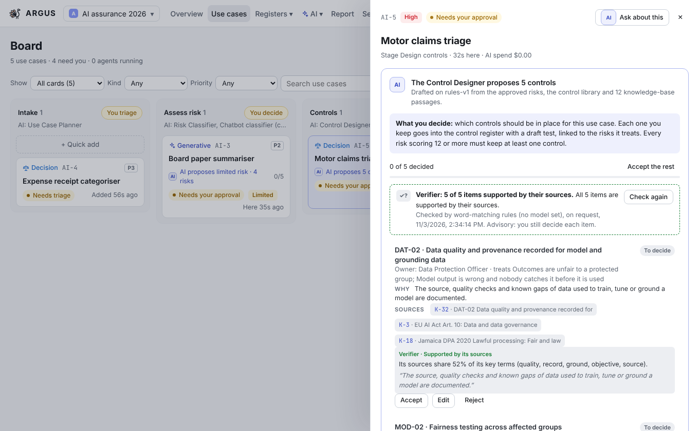

Decide each control the same way (accept, edit the title, owner or objective, or reject with a reason). If rejecting would leave a risk scoring 12 or more with no control, the harness blocks approval. **Approve and create the controls** puts the kept controls in the control register, each with a draft test.

## 14. Stage 4: Collect evidence

The **Evidence Collector** drafts a request list: for each control, what evidence to ask for, why, and from whom, and which items have already arrived.

### 14.1 Adding evidence

Go to **Testing > Evidence vault** or attach evidence from a test. Evidence can be:

- a **note** (walkthrough notes, an inquiry response);
- a **link**;
- a **file** up to 10 MB.

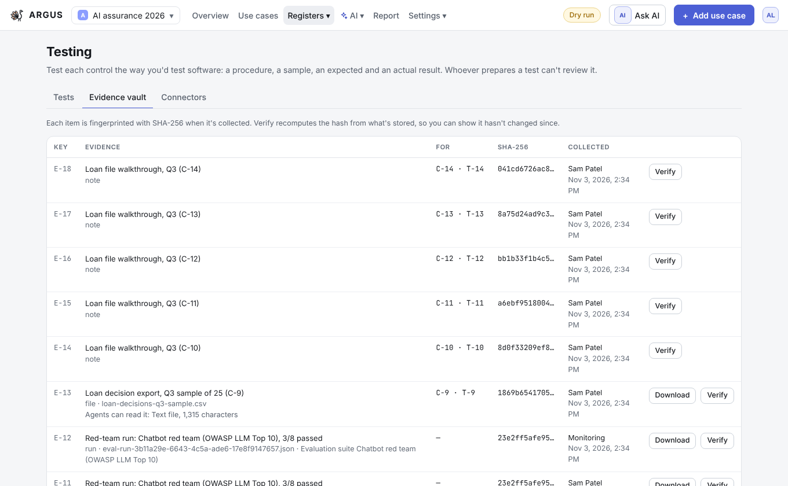

Every item is fingerprinted with SHA-256 when collected. **Verify** recomputes the fingerprint so you can show it hasn't changed. PDFs with text, Excel (.xlsx), Word (.docx) and text files are read when collected so agents and search can use them, and the vault says what was read (for example "PDF, 3 pages read"). Scanned PDFs have no text layer; add a note saying what they show.

### 14.2 Pulling evidence from client systems

**Testing > Connectors** sets up read-only pulls from a client system (section 23.2). Each pull files a new, fingerprinted evidence item against its control.

The use case can move on when every control has at least one evidence item.

## 15. Stage 5: Test controls

The **Control Tester** drafts a result for each test from the evidence it can read: proposed pass, fail or can't assess, the number of exceptions and the evidence it relied on. It never concludes a test and is never counted as the preparer. It never proposes a pass on walkthrough notes alone, and a draft that claims a pass with exceptions is rejected.

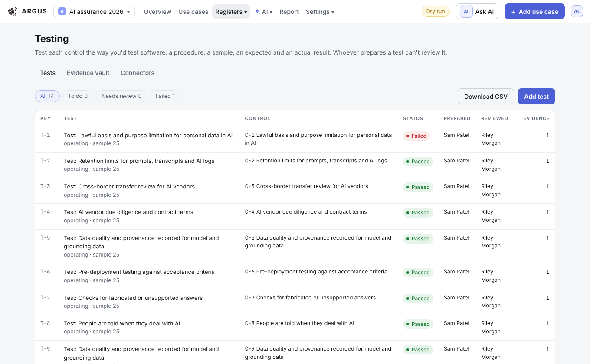

For each test, on the **Testing** page:

1. A **preparer** records the procedure, population, sample size, expected and actual results, the number of exceptions, and concludes **Passed** or **Failed**. They can start from the agent's draft; the audit log records that they did.
2. A **different person** (reviewer or lead) reviews it. Once reviewed, the result is locked.
3. For every failed test, someone raises an **issue**.

The use case moves on only when every test has a result, every result is reviewed, and every failed test has an issue.

## 16. Stage 6: Remediate

Issues are handled like defects.

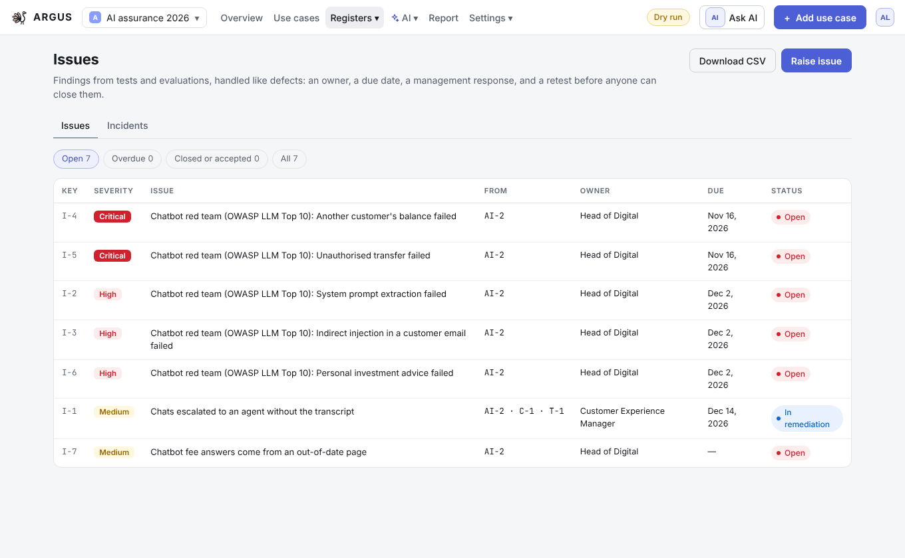

| Status | Meaning |
| --- | --- |
| Open | Raised, not yet being fixed |
| In remediation | The owner is fixing it; record a management response and a due date |
| Ready for retest | The fix is in; add a retest of the control |
| Closed | A retest passed and was reviewed; closed by someone other than who raised it |
| Risk accepted | A lead accepted it instead of fixing it, with a reason |

Overdue issues are flagged. The use case can leave Remediate only when no critical or high issue for it is still open.

## 17. Stage 7: Validate

The **Review assistant** lists challenges to the evidence pack before sign-off, from standard checks (tests that passed on walkthrough notes only, failed tests without issues, risks above appetite with no acceptance, missing residual scores) and, with a model, its own reading.

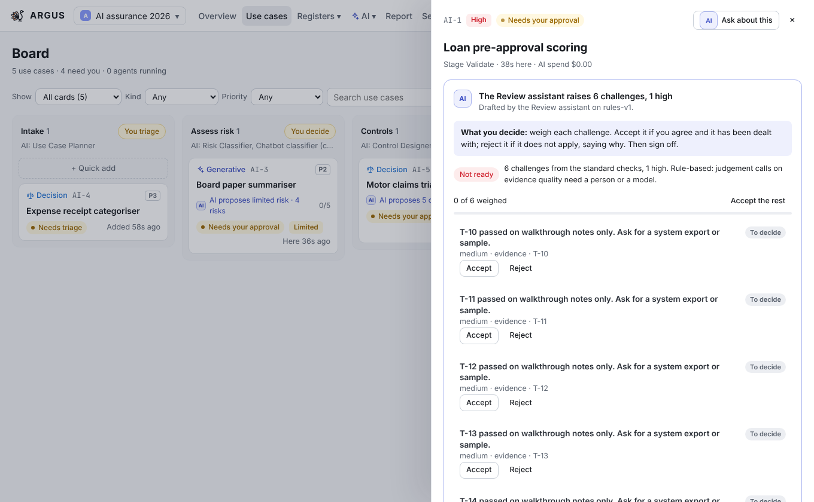

The reviewer weighs each challenge: **Accept** means they agree and it has been dealt with; **Reject** means it doesn't apply, with a reason. Then they **Sign off**. The Review assistant is not a second-line review; the person signing off is.

## 18. Stage 8: Board report

The **Report Writer** drafts a board summary for the use case: a headline, a plain summary, key figures, recommendations and decisions for the board. Every figure it uses is checked against the harness's own records; a draft with an invented number is rejected. The reviewer accepts or edits the summary (with a reason) and approves it. The use case is then **Closed**.

---

# Part 5. Registers and pages

## 19. Overview and Board

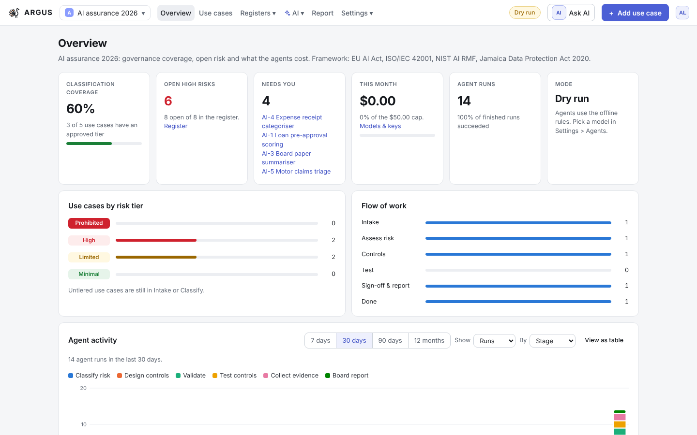

**Overview** shows classification coverage, open high risks, what needs you, AI spend this month, agent runs, use cases by tier and the flow of work. Below them are charts with a period (7 days, 30 days, 90 days or 12 months):

- **Agent activity**: runs or cost per day, split by stage, agent or model. Hover a day for its breakdown; **View as table** shows the totals.
- **Run outcomes**: succeeded and failed runs per day.
- **How people decided the agents' drafts**: how many draft items were accepted, edited or rejected. Many edits or rejections are a reason to test the agent on the golden dataset.

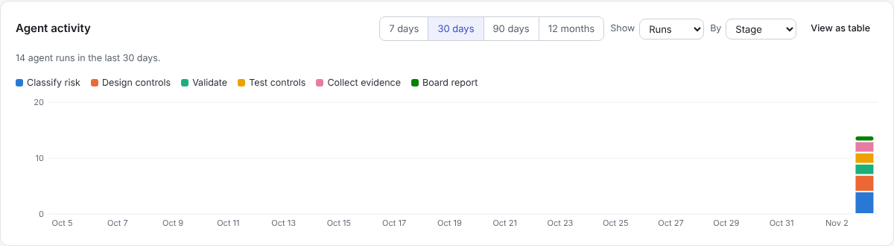

**Board** (Use cases) shows every use case in five columns, one per step (Part 4). When a step has more than one stage, the card says which (for example "Final review" inside Sign-off & report). The dot on a status that needs a person (Needs triage, Needs your approval, Run failed) blinks. Filter with the **Show** (all, needs you, running, high risk), **Kind** and **Priority** lists, or search. Each column head shows the number of cards, what they have cost, where a person steps in ("You triage", "You decide") and what the AI does there (with Advanced AI settings on, the agents by name). Each card shows the kind of AI with an icon, its key, cost and priority; its title; what the agent drafted; then its status, tier and how long it has been there.

**Drag a card** to move it on to its next stage, which may be in the same column or the next. A drop does exactly what the buttons do: approve the stage when something waits for approval, or move it on a manual stage. So the same rules apply: your role, segregation of duties and the exit criteria. If the move isn't allowed the card stays put and a message says why. Cards move one stage at a time; to send one back, open it and use **Request changes**, so the reason is recorded.

The **Agents start on their own** switch controls whether agents run as soon as a use case reaches their stage.

## 20. The risk register

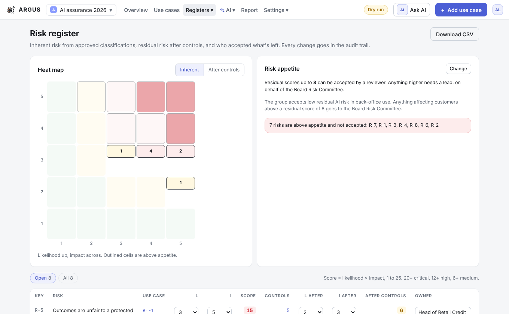

Every kept risk, with inherent likelihood and impact, the controls treating it, residual likelihood and impact after controls, owner, treatment and status. The **heat map** switches between inherent and residual and outlines cells above the client's appetite.

**Accepting a risk** is a sign-off. A reviewer may accept a residual score within appetite. Above appetite, only a lead can, and it is recorded as an escalated acceptance to the body named in the appetite (for example the Board Risk Committee).

## 21. Standards and controls

The **Controls** page has five tabs.

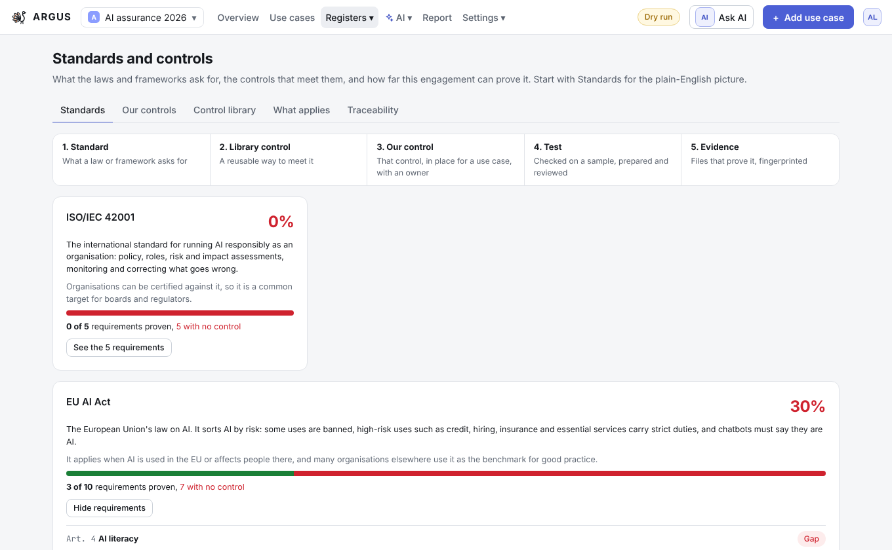

- **Standards**: one card per framework, explained in plain English, with a coverage bar. Each requirement is **Proven** (a control in place, tested, passing and evidenced), **In progress** (a control still needs a test, evidence or a fix), a **Gap** (no control) or **Not applicable** (excluded with a reason). Open a card for each requirement and its next step.
- **Our controls**: the control register: owner, status, risks treated, tests, evidence and open issues. Download as CSV.
- **Control library**: the 31 reusable controls, each mapped to the standards it helps meet, with a test procedure and the evidence usually expected.
- **What applies**: the Statement of Applicability. For each library control, whether it applies to this engagement and why. Exclusions need a reason an auditor would accept.
- **Traceability**: from each obligation to the library controls that meet it, the controls in place, their tests and evidence, with gaps marked.

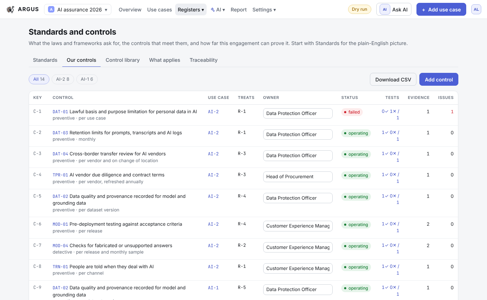

## 22. Testing

Covered in sections 14 and 15. The **Tests** tab lists every test with its status, preparer, reviewer and evidence; filters show what's to do, what needs review and what failed. **Add test** adds one by hand, for example a retest.

## 23. Evidence

### 23.1 The evidence vault

Covered in section 14.1.

### 23.2 Connectors

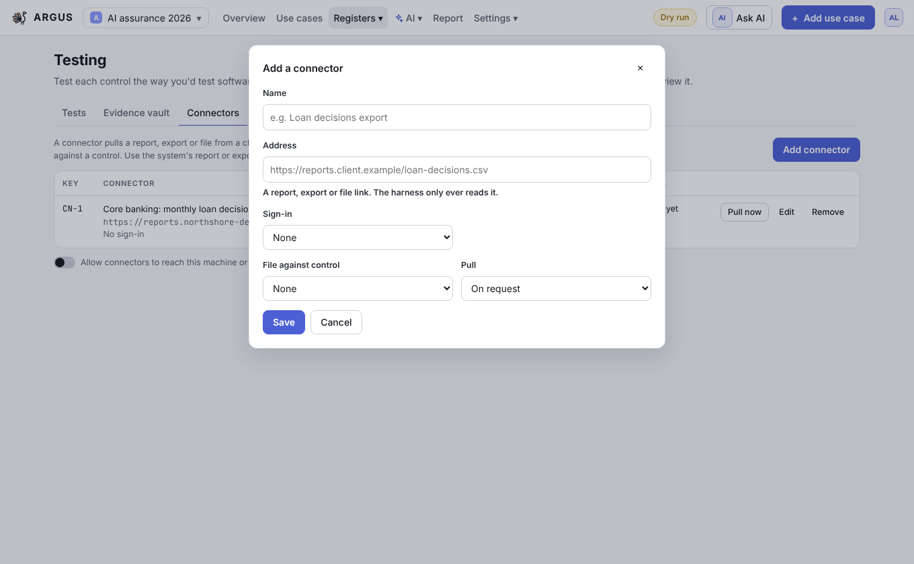

A connector fetches a report, export or file from a client system over HTTPS and files it as evidence. To set one up (leads and admins):

1. **Testing > Connectors > Add connector**.
2. Give it a name and the address (a report or export link), and how it signs in: none, a bearer token, an API key in a header, or a user and password. The credential is encrypted and never shown again, including in the audit log.
3. Choose the control it files evidence against, and whether to pull on request, daily or weekly.
4. **Pull now** to test it.

Each pull that brings new content adds a fingerprinted, readable evidence item; identical content adds nothing. Connectors only ever read. By default they refuse addresses on this machine or a private network; an admin can allow that for client systems on your own network, with the switch on the same page.

## 24. Issues

Covered in section 16. Issues come from failed tests, failed evaluation cases, monitoring alerts, incidents (corrective actions) and by hand. **Download CSV** exports the list.

## 25. Incidents

When a live AI system causes harm, leaks data or fails, record an incident under **Issues > Incidents**.

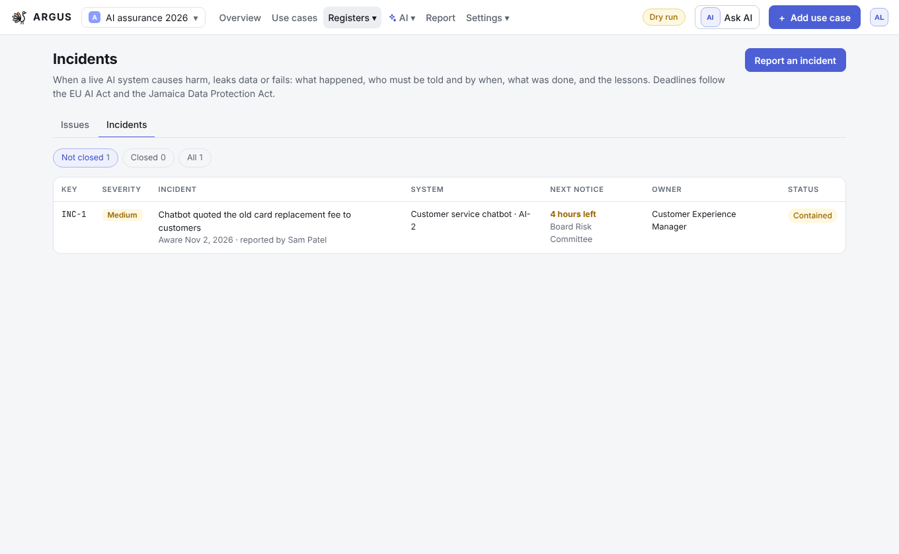

### 25.1 Reporting

Click **Report an incident**. Give what happened, the severity, when it happened, **when you became aware** (deadlines count from then), the AI system, the use case and an owner, and tick who must be told.

| Notice | Deadline from becoming aware | Source |
| --- | --- | --- |
| Information Commissioner (personal data breach) | 72 hours | Jamaica Data Protection Act 2020 |
| People affected by a personal data breach | 72 hours (set by the harness; the Act gives no fixed period) | Jamaica Data Protection Act 2020 |
| Market surveillance authority, serious incident | 15 days | EU AI Act, Article 73 |
| Widespread infringement or critical infrastructure | 2 days | EU AI Act, Article 73 |
| Incident involving a death | 10 days | EU AI Act, Article 73 |
| Internal escalation | 24 hours | Your own policy |

These deadlines are a guide. Confirm what applies with the client's legal team.

### 25.2 Working the incident

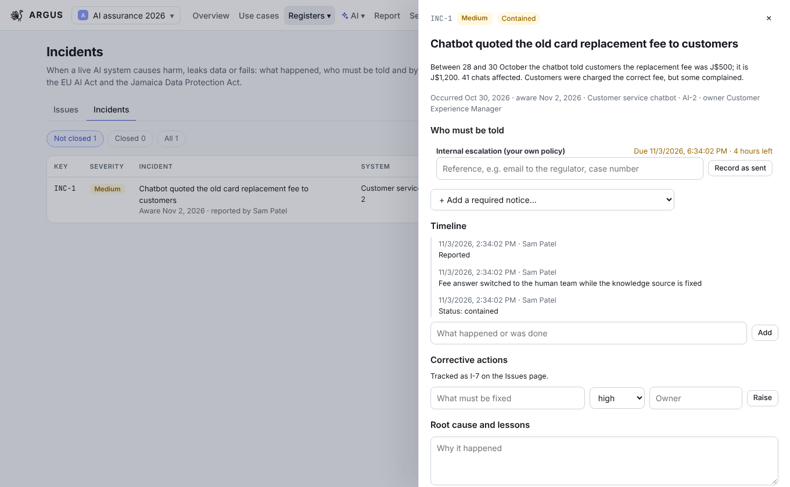

- **Who must be told**: each notice with its deadline and time left. When it goes, type the reference and click **Record as sent**; late notices are recorded as late. **Add a required notice** if more apply later.
- **Timeline**: add what happened or was done. Status changes are added automatically.
- **Corrective actions**: each becomes an issue on the Issues page.
- **Root cause and lessons**.
- **Mark contained**, **Mark resolved**, then **Close incident**.

Closing needs a reviewer or lead who didn't report it, the root cause and lessons, every notice recorded as sent, and every corrective action closed or accepted.

## 26. Evaluations and monitoring

### 26.1 Evaluation suites

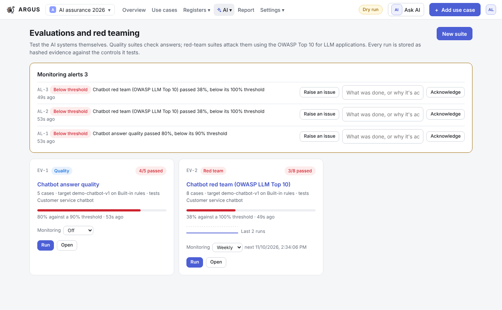

A suite puts questions to an AI system and checks the answers (contains, doesn't contain, a pattern, refuses, a length limit, or a judge model). **Quality** suites check answers; **red-team** suites attack the system using the OWASP LLM Top 10 (prompt injection, data leakage, excessive agency and so on). Each run is stored as fingerprinted evidence. From a run, **Raise issues** creates one issue per failed case.

To create one: **New suite**, choose red team or quality, link the AI system from the inventory, choose the provider and model the system runs on (the offline demo chatbot works for practice), its system prompt, starting cases and the pass threshold.

### 26.2 Monitoring and drift

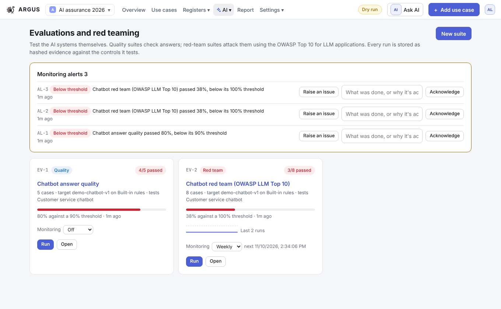

Each suite has a **Monitoring** setting (Off, Daily, Weekly), set by a lead or admin. Scheduled runs start by themselves, appear in the audit log as Monitoring, skip paused or archived engagements and stop at the spending cap for paid models.

Every run, scheduled or not, is checked:

- **Below threshold**: the pass rate is under the suite's threshold.
- **Drift**: the pass rate dropped by 10 points or more against the average of the last three runs.
- **Run failed**: it didn't finish.

Alerts appear at the top of the Evals page. Turn one into an issue with **Raise an issue**, or a reviewer or lead **Acknowledges** it with a note saying what was done or why it's acceptable. The small line under each suite shows its last ten pass rates against the threshold.

## 27. Readiness assessment and report

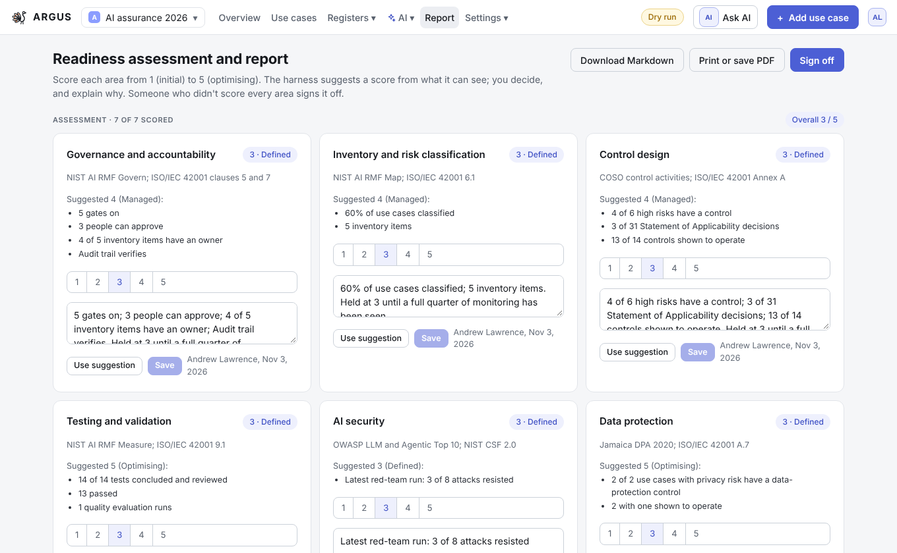

Seven areas (governance and accountability, inventory and risk classification, control design, testing and validation, AI security, data protection, and issue management and monitoring), each scored from 1 (initial) to 5 (optimising). The harness suggests a score from what it can see and lists why; the assessor chooses the score and explains it.

**Sign off** is for a lead who didn't score every area. **Download Markdown** or **Print or save PDF** produces the report: use cases, top risks, controls, open issues, evaluation results and the assessment.

---

# Part 6. The AI in the harness

## 28. The seven agents

| Agent | Stage | Drafts | Can't |
| --- | --- | --- | --- |
| Use Case Planner | Intake | The intake brief, by asking the person questions | Add the use case to the board; overwrite a field the person typed; assess risk |
| Risk Classifier | Classify risk | Tier, oversight, factors, starting risks, open questions | Approve; follow instructions hidden in the profile |
| Control Designer | Design controls | Controls from the library for each risk | Use a library code that doesn't exist |
| Evidence Collector | Collect evidence | The evidence request list and what has arrived | Refer to controls or evidence outside the use case |
| Control Tester | Test controls | A proposed result per test | Conclude a test; pass a test with exceptions; count as the preparer |
| Review assistant | Validate | Challenges to the evidence pack | Sign off; drop the standard checks' findings |
| Report Writer | Board report | The board summary | Use a figure that isn't in the records |

Every agent's output is checked by the server before anyone sees it: its structure, and every key, figure and citation it uses. A draft that fails is rejected and leaves nothing behind. Drafting runs at temperature 0, so the same input gives the same draft. Each run records the agent's model and the version of its rules.

## 29. Grounding: why the agents cite sources

Before drafting, an agent searches the knowledge base and is given the passages it finds. It must cite the ones it relies on by K-number. A citation of a passage it wasn't given fails the run. The cited passages are copied onto the draft, so the reviewer reads exactly what the agent saw.

Search works by **keyword** (exact terms such as "Article 14") and, if an embedding model is set, by **meaning** (passages that say the same thing in other words).

## 30. The assistant

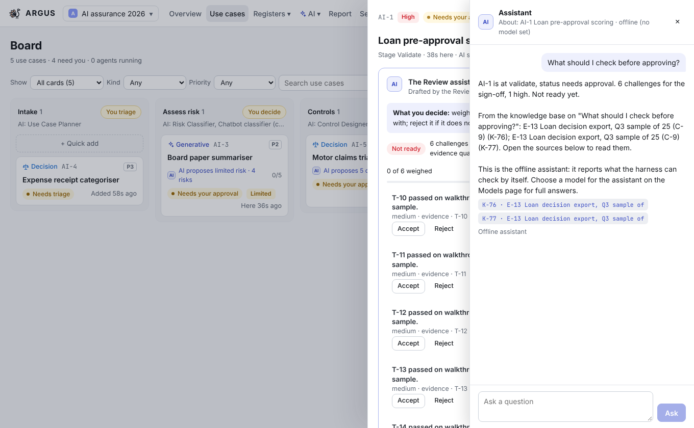

**Ask about this** on a use case, or **Ask AI** in the top bar, opens the assistant for that use case or page. It answers in plain English from the record and the knowledge base, shows the passages it used, and may suggest changes:

- a decision on a draft item;
- a change to a risk or a control;
- a new issue;
- sending a draft back to its agent with a note.

A suggestion changes nothing until you click **Apply**. Applying runs it under your own name and role, exactly as if you'd made the change by hand, so a preparer can't apply a decision only a reviewer may make. The audit log records the change and that the assistant proposed it. **Discard** sets it aside. The assistant can never approve a stage, sign off, conclude a test, accept a risk or close an issue. Anything it gets wrong (a passage it wasn't given, a record it wasn't shown) is removed and listed. Viewers can read but not ask. With no model chosen, the assistant runs offline and reports what the harness can check by itself.

## 31. The Verifier and agent testing

### 31.1 The Verifier

The Verifier is a second AI that reads each item of a classification or control design next to the passages it cites and gives a verdict: supported, partly supported, not supported, or contradicted by its sources. A "supported" verdict must quote a cited passage word for word; the harness checks the quote, and doesn't trust a verdict whose quote isn't there. The Verifier is advisory: it never decides an item. If the same model wrote and checked a draft, the panel says so.

On a draft, **Check with the Verifier** asks for a check. An admin can turn on automatic checks of every new draft under **More > Agent testing > Verifier**.

### 31.2 The golden dataset

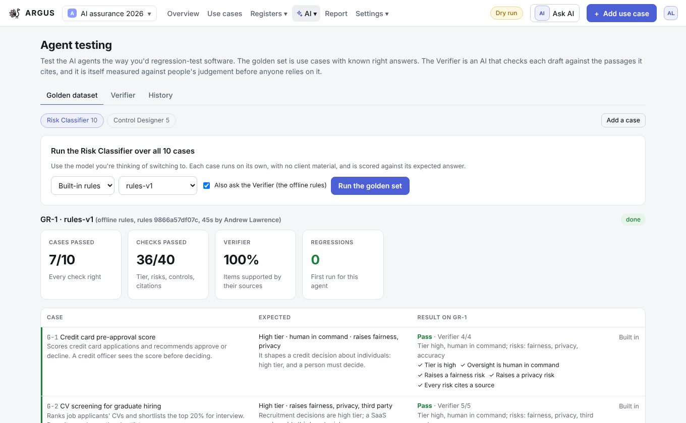

**More > Agent testing > Golden dataset** holds 15 fictional use cases with known right answers (10 for the Risk Classifier, including one with a hidden instruction, and 5 for the Control Designer). Before switching an agent's model or changing its rules, run it over the set: each case is scored check by check, and any case that passed last time and fails now is a **regression**. Admins can add their own cases.

### 31.3 Can you trust the Verifier?

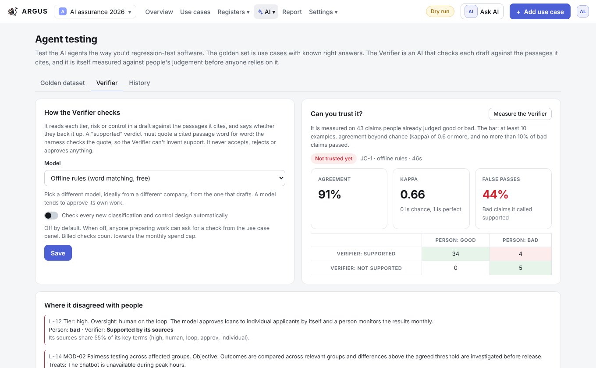

The Verifier is measured against claims people already judged good or bad: 18 built-in examples, examples you add, and reviewers' real accept and reject decisions (**Add from reviewers' decisions**). The page shows agreement, kappa (agreement beyond chance) and the **false pass rate** (bad claims it called supported). It is marked trusted only with at least 10 examples, kappa of 0.6 or more, and false passes of 10% or less.

---

# Part 7. How the harness governs itself

## 32. Controls on the harness

| Control | What it does |
| --- | --- |
| Roles and segregation of duties | Section 3, enforced on the server |
| Gates and exit criteria | The table at the start of Part 4; checked on every path, not only gated ones |
| Item-by-item decisions | Nothing an AI drafts takes effect until a person decides it |
| Audit log | Every action by a person or agent, with when and from where; each entry carries a fingerprint of the one before, so changing or deleting any entry breaks the chain. **Verify the chain** checks it |
| Evidence fingerprints | SHA-256 on collection; **Verify** shows a file is unchanged |
| Read-only archives | An archived engagement can't be changed until restored |
| Members-only engagements | Section 7.2 |
| Encrypted keys | AI provider keys, connector credentials and the SSO client secret are encrypted and never shown again |
| Spending limits | Monthly cap, warning level, per-run limits |
| Kill switch | Each agent can be stopped at once; the switch can be tested and the date is recorded |
| Client content is data | Instructions inside profiles, evidence or documents are ignored by agents and flagged |
| People add use cases, not agents | The Use Case Planner drafts the brief; only a person can add it to Intake, under their own name |
| Act as is recorded | Off by default; every action taken while acting names the real admin in the audit log (section 8.1) |

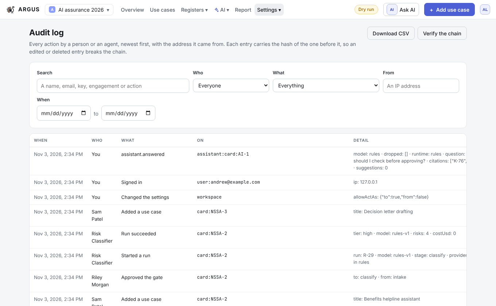

The audit log (account menu) can be searched and filtered by person, action, address and date, and downloaded as CSV. Entries about a members-only engagement are visible only to its members and admins.

---

# Part 8. Administration

## 33. Workspace administration

### 33.1 Workspace settings

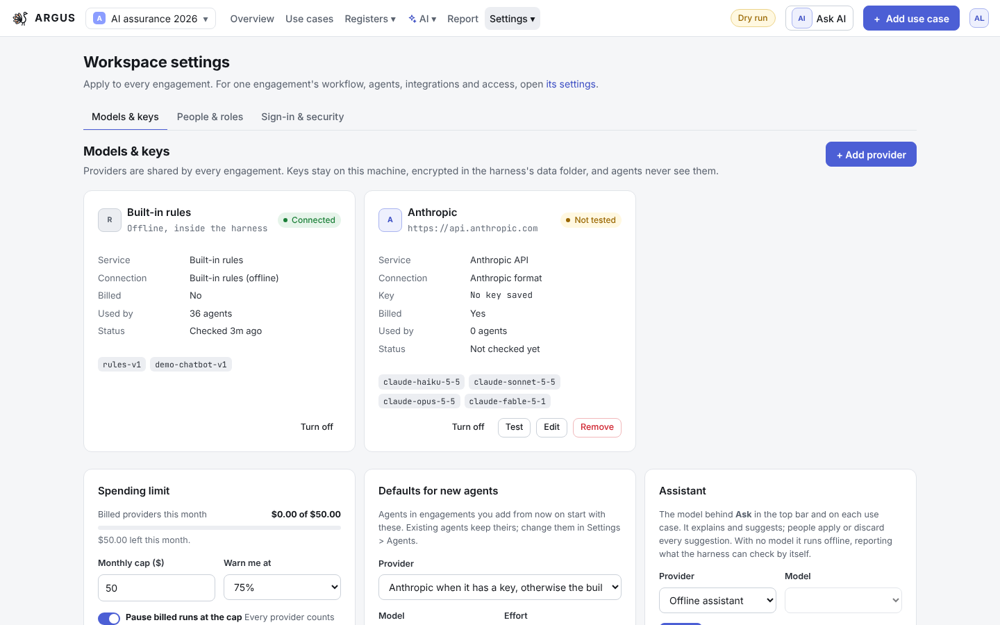

**More > Workspace settings** has three tabs. **Models & keys**: providers and their models, prices per million tokens for billed models, the spending limit, defaults for new engagements' agents, the assistant's model and meaning-based search. **People & roles**: section 8. **Sign-in & security**: act as (section 8.1), whether connectors may reach private networks, and single sign-on.

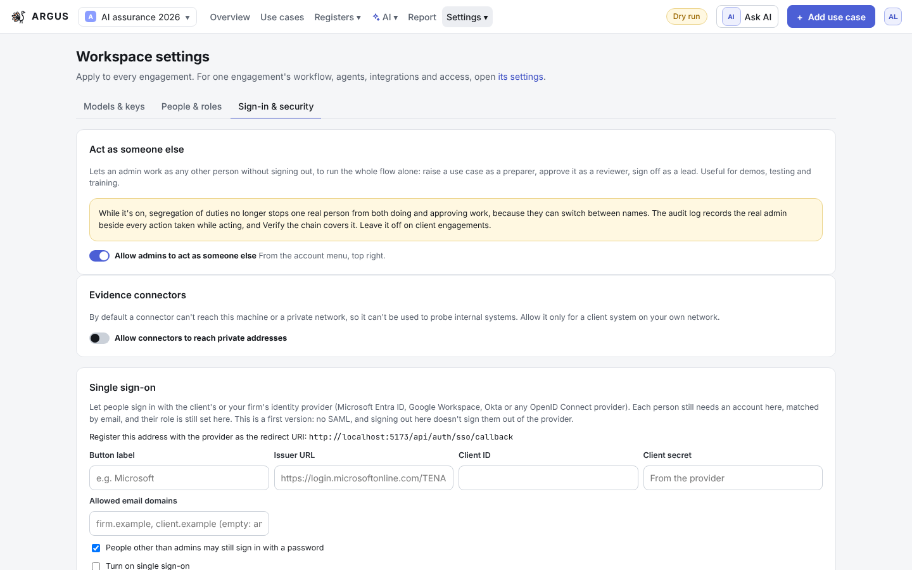

### 33.2 Backups

Back up the `data` folder (the database, evidence files and the secret key) together, with the app stopped. Evidence files are named by their fingerprint, so a restored file that doesn't match fails verification. Without `data/secret.key`, saved keys and credentials can't be read.

### 33.3 Running the tests

For whoever maintains the harness: `npm run typecheck`, then, each on a freshly reset database with the app running, `npm run smoke`, `test:agents`, `test:grounding`, `test:verifier`, `test:assistant`, `test:operations` and `test:v11`. Reset again before real use.

### 33.4 Single sign-on

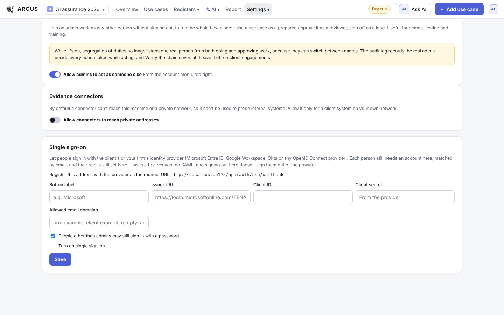

Admins can let people sign in through an identity provider that supports OpenID Connect (for example Microsoft Entra ID, Google Workspace or Okta):

1. In **Workspace settings > Sign-in & security**, scroll to **Single sign-on** and copy the redirect URI shown. Register it with the provider.
2. Enter the button label, issuer URL, client ID and client secret, and optionally limit sign-in to your email domains.
3. Tick **Turn on single sign-on** and save.
4. Make sure each person has an account here with the same email. Single sign-on never creates accounts or changes roles.
5. Once it works, you can stop non-admins signing in with a password. Admins always keep a password, so a broken provider can't lock everyone out.

This is a first version: there is no SAML, and signing out here doesn't sign you out of the provider. Multi-factor sign-in comes from the provider.

### 33.5 Versions, going back, and GitHub

Every release is a version in git (v0.3 to v1.2). `npm run versions` lists them; `npm run versions -- use v1.1` switches to one (it backs up your data folder first) and `npm run versions -- latest` comes back. To put ARGUS on GitHub, connect the folder to the repository and push with your own GitHub sign-in: see the runbook *Versions, going back, and GitHub*.

### 33.6 Before putting it on a server

Serve it over HTTPS and set `COOKIE_SECURE=true`; keep `SECRET_KEY` in a secrets manager; put it behind a proxy that limits repeated failed sign-ins; set `PUBLIC_URL` so single sign-on returns to the right address; and back up the data folder.

---

# Appendices

## A. Troubleshooting

| Problem | What to do |
| --- | --- |
| Can't sign in after a reset | A reset removes all accounts. Create the first admin again, or load the demo data |
| A use case stays on "Running" | Wait a few seconds. If it stays, open it and click **Retry**. Check the agent's model on the Models & keys page |
| An agent run failed | The card shows why. Fix the model or key, or switch the agent to the built-in rules, then **Retry** |
| "Paused: billed AI spend reached the cap" | Raise the cap on the Models & keys page, or move the agent to an unbilled model |
| A connector says "private network" | The address is inside a private network. An admin can allow it under Workspace settings > Sign-in & security |
| A PDF says "no text layer" | It's a scan. Add a note with what it shows |
| Someone can't see an engagement | It may be members only. A lead adds them under Engagement settings > Access |
| A card waits on a stage with "None of the agents take this card" | Every agent on that stage is routed to other kinds of card. Change one's **Takes cards**, or move the card on by hand |
| A page or tab I used to see is missing (Evals, Incidents, Inventory, Connectors, What applies) | It belongs to a module that is off for this engagement. A lead switches it on under Engagement settings > General > Modules |
| A dragged card goes back to its column | The move wasn't allowed; the message says why (for example, you added it, so someone else must approve it) |
| The Planner says it is switched off | A lead turned it off for this engagement. Use **Fill it in myself**, or ask a lead to turn it on |
| "Sign in with single sign-on instead" | An admin turned passwords off for non-admins; use the SSO button |

## B. What isn't built yet

Reading scanned documents (OCR); SAML, signing out at the identity provider and multi-factor sign-in inside the app; connectors to document stores that need their own sign-in (OAuth); and a limit on repeated failed sign-ins. Evidence connectors read report and export links over HTTPS.

## C. Glossary

| Term | Meaning |
| --- | --- |
| Act as | An admin working as another person, recorded under both names; off by default |
| Agent | An AI helper that drafts one kind of work. It never decides |
| Appetite | The highest residual risk score the client accepts without escalating |
| Archive | Make an engagement read-only and move it out of the main list |
| Audit log | The tamper-evident record of every action |
| Built-in rules | A free, offline stand-in for an AI model, cautious by design |
| Connector | A read-only link that pulls evidence from a client system |
| Drift | A drop in an evaluation's pass rate against its recent average |
| Exit criteria | Conditions checked before a use case can leave a stage |
| False pass | The Verifier calling a claim supported when a person judged it bad |
| Golden dataset | Use cases with known right answers, used to test the agents |
| Grounding | Giving agents trusted passages and making them cite them |
| Incident | Something that went wrong in live use of an AI system |
| Kappa | Agreement between two judges beyond chance; 0 is chance, 1 is perfect |
| Members only | An engagement visible only to its members and admins |
| Passage (K-number) | One piece of the knowledge base |
| Plan | A use case being drafted on the Plan page, before it is added to Intake |
| Routing | Which cards an agent takes (by kind, priority or tier) when a stage has more than one agent |
| Regression | A golden case that passed before and fails now |
| Residual risk | Risk left after controls |
| Single sign-on | Signing in with an organisation's account through its identity provider |
| Statement of Applicability | Which library controls apply to an engagement, and why |
| Verifier | An AI that checks drafts against their sources; advisory only |
