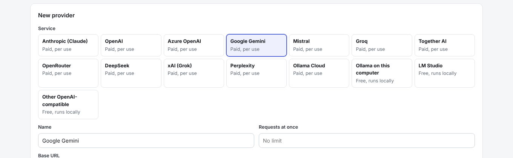

# Add a model provider

**Who:** admins. **You need:** an API key from the provider (not needed for a model on your own server).

1. Go to **More, Models**.
2. For Claude: edit the **Anthropic** card and paste your key. For anything else: **+ Add provider** and pick the service. The address and billing are filled in, and the form says where to get the key.

   | Service | Notes |
   | --- | --- |
   | Anthropic (Claude), OpenAI, Google Gemini, Mistral, Groq, Together AI, OpenRouter, xAI | Paste the key and test |
   | Azure OpenAI | Replace YOUR-RESOURCE in the address with your resource name, and add your deployment names as models |
   | DeepSeek | Check where client data is processed before using it on client work |
   | Perplexity | Add model names by hand (for example `sonar`). It answers in JSON rather than tool calls; the harness handles that |
   | Ollama Cloud | Key from ollama.com |
   | Ollama on this computer, LM Studio | Free and private. Start the app and load a model first. No key |
   | Other OpenAI-compatible | vLLM, llama.cpp, a company gateway. Usually ends in `/v1` |

   

3. Click **Test and find models**. The harness lists the models it finds. Add any it misses by name.
4. If the provider charges, leave **Billed** on and enter each model's price per million tokens (Anthropic's are filled in).
5. Save.
6. Optionally, make it the model for the **Assistant** (on the Models page) or the **Verifier** (More, Agent testing, Verifier).
7. Point agents at it: **More, Settings, Agents**, pick an agent, choose the provider and model, optionally a fallback, and **Save agent**. Repeat for each agent. The badge at the top changes from **Dry run** to **Live agents**.

## Notes

- Keys are encrypted and shown only as their last four characters.
- A provider in use by an agent can't be removed. Move the agents first.
- When the monthly spending cap is reached and **pause at the cap** is on, billed runs stop with a note on the use case.
