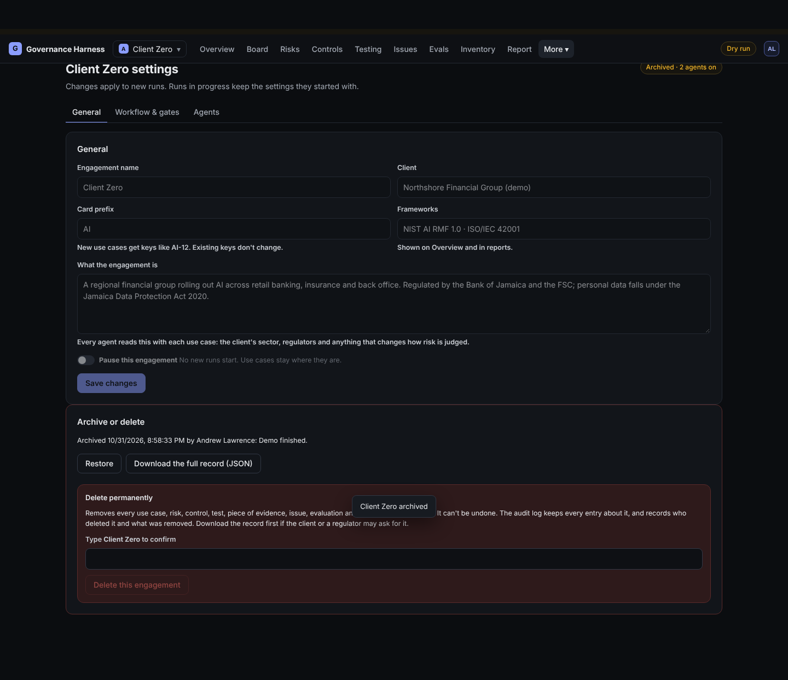
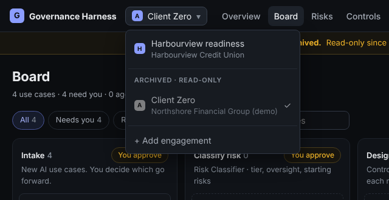

# Archive or delete an engagement

Where: switch to the engagement, then **More, Settings, General**, section **Archive or delete**.

## Archive (leads and admins)

1. Optionally type a reason (it goes in the audit log).
2. **Archive this engagement**.

It becomes read-only: nobody can change anything in it, and agents stop working on it. It moves to the **Archived** section of the switcher, with a banner on every page.

 Nothing is removed. You can't archive the only active engagement, and you can't archive while an agent is mid-run.

## Restore

Same place: **Restore**. It becomes writable again.

## Download the full record

On an archived engagement: **Download the full record (JSON)**. One file with everything in it, including its audit entries. Evidence files are listed by fingerprint; download any you need from the evidence vault first.

## Delete permanently (admins only)

1. Archive it first.
2. Download the full record if the client or a regulator may ask for it later.
3. Type the engagement's exact name and click **Delete this engagement**.

Everything in it is removed, including evidence files no other engagement uses. This can't be undone. The audit log keeps every entry about it, plus who deleted it and counts of what was removed.
