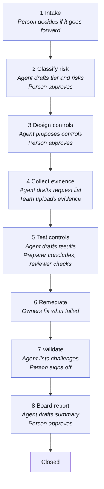

# Assess a use case end to end

**Who:** the engagement team. Roles needed: a **preparer** to do the work and a **reviewer** (or lead) to approve. It can't be one person, by design.

## 1. Intake

1. Anyone preparing clicks **+ Add use case** and fills in the profile: business owner, what it does, data used, people affected, how much it acts on its own, vendor or model. Better descriptions give better classifications.
2. A reviewer opens the card and chooses **Send to classification**, or **Don't take forward** with a note.

## 2. Classify risk

1. The Risk Classifier drafts a tier, the oversight needed, the factors behind them, starting risks and questions for the owner.
2. The reviewer reads it and either **Approves**, which adds the risks to the risk register, or chooses **Request changes** with a note saying what to fix.

## 3. Design controls

1. The Control Designer proposes controls from the library for each risk, with an owner and a test approach.
2. The reviewer approves. Each control goes into the register, linked to its risks, with a draft test.

## 4. Collect evidence

1. If the Evidence Collector is on, it drafts the list of what to ask the client for. Otherwise, use each control's "evidence usually expected" from the library.
2. Preparers upload evidence: **Testing**, open a test, **Attach evidence** (file up to 10 MB, a link, or a note).
3. When every control has evidence, a reviewer moves the card on.

## 5. Test controls

1. Open each test on the **Testing** page. If the Control Tester ran, its draft is at the top. **Start from this draft** copies it in. Check it against the evidence; it's only a suggestion.
2. Fill in the population, sample size, actual result and exceptions.
3. **Conclude: passed** or **Conclude: failed**. You're recorded as the preparer. A test with exceptions can't pass.
4. A different person opens **Needs review** and clicks **Review and sign off**. The result is then locked.
5. Once a failed test is reviewed, open it and click **Raise an issue**.
6. When every test is concluded and reviewed, and every failure has an issue, a reviewer moves the card on.

## 6. Remediate

1. On **Issues**, each owner adds a management response and a due date, and moves the issue to **In remediation**, then **Ready for retest**.
2. Add a **retest** for the control (on the failed test, **Add a retest**), conclude it, and have it reviewed.
3. A reviewer closes the issue. It can't be closed without a passed, reviewed retest. If the client accepts the risk instead, someone with authority chooses **Accept the risk** and gives a reason.
4. When no critical or high issue is open, the card moves on.

## 7. Validate

1. If the Review assistant is on, it lists challenges. Read them; fix what matters.
2. A reviewer **signs off**.

## 8. Board report

1. If the Report Writer is on, it drafts a summary from the harness's figures.
2. A reviewer reads it and **approves** it. It then appears in the readiness report.

## Along the way

- Set residual scores and accept risks on the **Risks** page.
- If a step is blocked, the card's panel lists exactly what's missing under **Exit criteria**.
