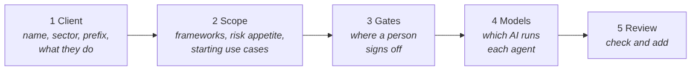
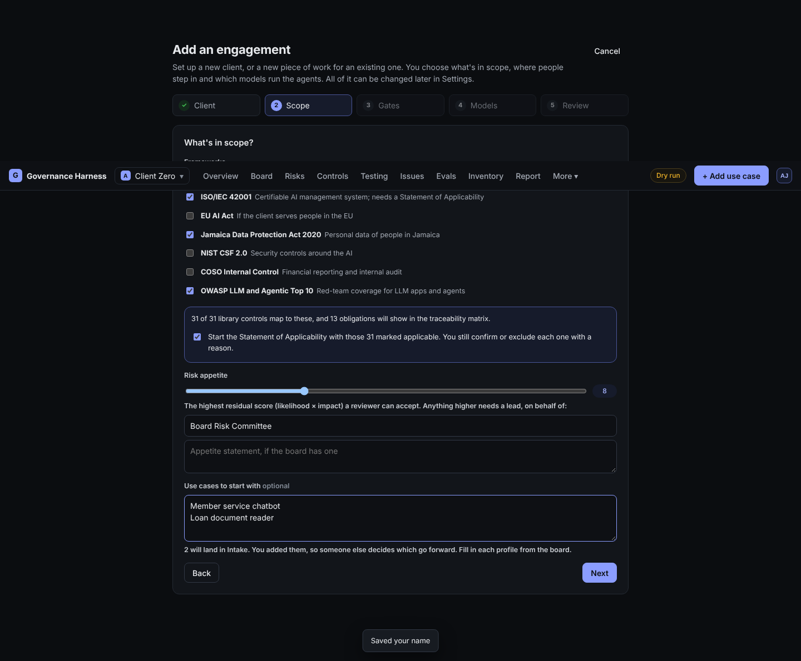
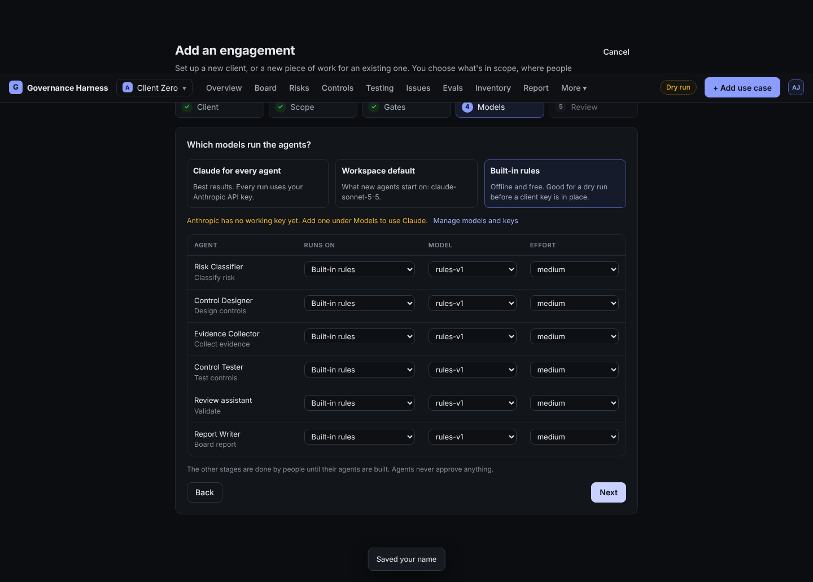

# Start a new engagement

**Who:** leads and admins. **You need:** the client's name, which frameworks are in scope, and their risk appetite if they have one.

1. Click the engagement switcher (top left), then **+ Add engagement**.
2. **Client**: client name, sector, engagement name, card prefix (filled in from the client's initials; it must be unique, because use cases are numbered with it), colour, and a short description of the client and who regulates them. The agents read the description as context.
3. **Scope**: tick the frameworks in scope. The harness shows how many library controls and obligations they bring in.
   - Leave **Start the Statement of Applicability** ticked to mark those controls applicable as a starting point. You still confirm or exclude each one later, with a reason.
   - Set the **risk appetite**: the highest residual score a reviewer can accept, and who accepts above it.
   - Optionally paste the use cases you already know about, one per line. They land in Intake. Because you added them, someone else decides which go forward.

   

4. **Gates**: choose where a person must sign off. The defaults (Intake, Classify, Design, Validate, Board report) suit most work.
5. **Models**: choose Claude for every agent, the workspace default, or the free built-in rules, then adjust per agent if needed.

   

6. **Review**: check everything and click **Add engagement**. You land on its board.

## Afterwards

- Turn on the drafting agents you want (Evidence Collector, Control Tester, Review assistant, Report Writer): **More, Settings, Agents**.
- Go through the Statement of Applicability (**Controls, Statement of Applicability**) and confirm or exclude each control.
- Add the client's AI systems to the **Inventory**.
